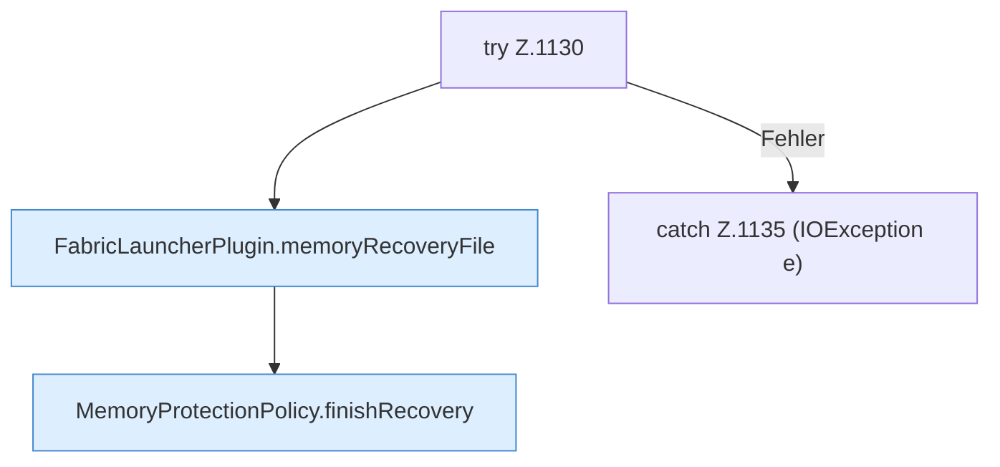

[[00 Start]] › [[Host-Betrieb]] › [[Speicher-Stopp]] › [[FabricLauncherPlugin.clearMemoryRecoveryState]] › [[FabricLauncherPlugin.clearMemoryRecoveryState.Z1130]]

# FabricLauncherPlugin.clearMemoryRecoveryState.Z1130

- Fortsetzung von `FabricLauncherPlugin.clearMemoryRecoveryState`, Quellreihenfolge.
