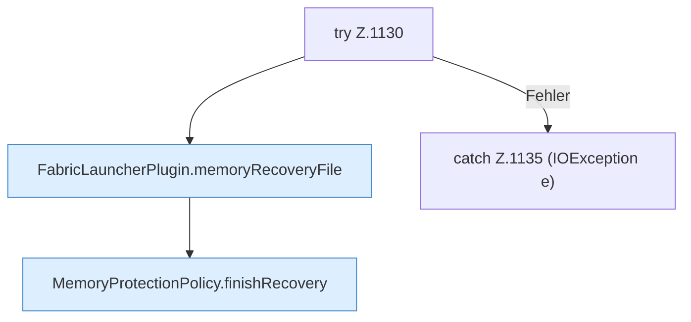

[[00 Start]] › [[Host-Betrieb]] › [[Speicher-Stopp]] › [[FabricLauncherPlugin.clearMemoryRecoveryState]] › [[FabricLauncherPlugin.clearMemoryRecoveryState.Z1130]]

# FabricLauncherPlugin.clearMemoryRecoveryState.Z1130



```knoten
try Z.1130
  Zeile 1130: Versuch. Der Fehlerpfad geht in catch.
FabricLauncherPlugin.memoryRecoveryFile
  Betrifft den Speicher `memoryRecoveryFile`.
MemoryProtectionPolicy.finishRecovery
  Schließt ab `finishRecovery`.
catch Z.1135 (IOException e)
  Zeile 1135: fängt (IOException e).
```

- Fortsetzung von `FabricLauncherPlugin.clearMemoryRecoveryState`, Quellreihenfolge.
