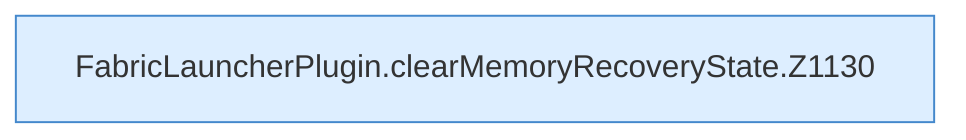

[[00 Start]] › [[Host-Betrieb]] › [[Speicher-Stopp]] › [[FabricLauncherPlugin.clearMemoryRecoveryState]]

# FabricLauncherPlugin.clearMemoryRecoveryState

`FabricLauncherPlugin.clearMemoryRecoveryState()` [src/main/java/de/aichele/childlauncher/FabricLauncherPlugin.java:1129–1138](https://github.com/Sciddie/minecraft-serverhoster-plugin/blob/95b02b953b0b4c23673e900e021a7c3c844aa37d/src/main/java/de/aichele/childlauncher/FabricLauncherPlugin.java#L1129-L1138)



```knoten
FabricLauncherPlugin.clearMemoryRecoveryState.Z1130
  Der Ablauf geht in [[Glossar#Zeile|Zeile]] 1130 weiter. Eine Ebene tiefer steht er genauer. Im [[Glossar#Quelltext|Quelltext]] heißt das `Z1130`.
```

> [!knoten]- Was die Blöcke tun
> - **FabricLauncherPlugin.clearMemoryRecoveryState.Z1130**: Der Ablauf geht in [[Glossar#Zeile|Zeile]] 1130 weiter. Eine Ebene tiefer steht er genauer. Im [[Glossar#Quelltext|Quelltext]] heißt das `Z1130`.

- Das [[Glossar#Plugin|Plugin]] löscht den gemerkten Stand von den [[Glossar#Arbeitsspeicher|Arbeitsspeicher]] die Wiederherstellung den Zustand.
