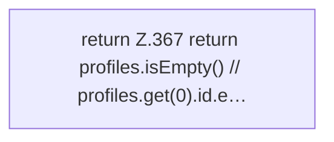

[[00 Start]] › [[Plugin-Kern]] › [[Properties]] › [[FabricLauncherPlugin.configPrefix]]

# FabricLauncherPlugin.configPrefix

`FabricLauncherPlugin.configPrefix(ServerProfile pr)` [src/main/java/de/aichele/childlauncher/FabricLauncherPlugin.java:366–368](https://github.com/Sciddie/minecraft-serverhoster-plugin/blob/95b02b953b0b4c23673e900e021a7c3c844aa37d/src/main/java/de/aichele/childlauncher/FabricLauncherPlugin.java#L366-L368)



```knoten
return Z.367 return profiles.isEmpty() // profiles.get(0).id.e…
  Hier endet die [[Glossar#Funktion|Funktion]] und liefert ein Ergebnis zurück. Das steht in [[Glossar#Zeile|Zeile]] 367.
```

> [!knoten]- Was die Blöcke tun
> - **return Z.367 return profiles.isEmpty() // profiles.get(0).id.e…**: Hier endet die [[Glossar#Funktion|Funktion]] und liefert ein Ergebnis zurück. Das steht in [[Glossar#Zeile|Zeile]] 367.

- Der Anfang der Namen, unter denen die Werte eines Servers in den [[Glossar#Einstellungen|Einstellungen]] stehen.
