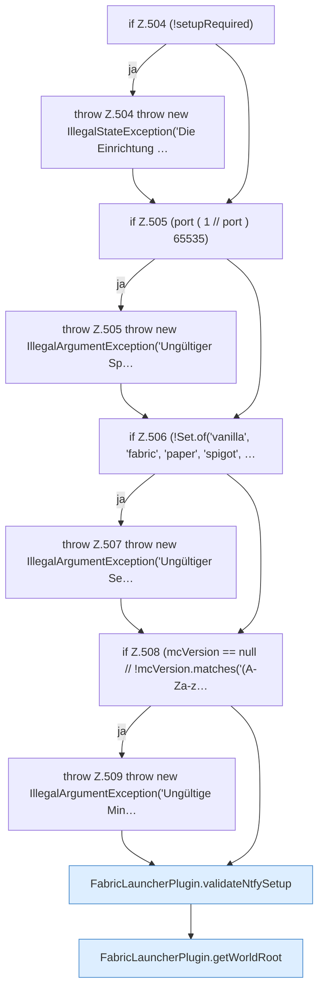

[[00 Start]] › [[Plugin-Kern]] › [[Setup]] › [[Setup-Dialog]] › [[FabricLauncherPlugin.configureSetup]] › [[FabricLauncherPlugin.configureSetup.Teil1]]

# FabricLauncherPlugin.configureSetup.Teil1



```knoten
if Z.504 (!setupRequired)
  Zeile 504: prüft `(!setupRequired)`.
throw Z.504 throw new IllegalStateException('Die Einrichtung …
  Zeile 504: Abbruch `throw new IllegalStateException('Die Einrichtung …`.
if Z.505 (port ( 1 // port ) 65535)
  Zeile 505: prüft `(port ( 1 // port ) 65535)`.
throw Z.505 throw new IllegalArgumentException('Ungültiger Sp…
  Zeile 505: Abbruch `throw new IllegalArgumentException('Ungültiger Sp…`.
if Z.506 (!Set.of('vanilla', 'fabric', 'paper', 'spigot', …
  Zeile 506: prüft `(!Set.of('vanilla', 'fabric', 'paper', 'spigot', …`.
throw Z.507 throw new IllegalArgumentException('Ungültiger Se…
  Zeile 507: Abbruch `throw new IllegalArgumentException('Ungültiger Se…`.
if Z.508 (mcVersion == null // !mcVersion.matches('(A-Za-z…
  Zeile 508: prüft `(mcVersion == null // !mcVersion.matches('(A-Za-z…`.
throw Z.509 throw new IllegalArgumentException('Ungültige Min…
  Zeile 509: Abbruch `throw new IllegalArgumentException('Ungültige Min…`.
FabricLauncherPlugin.validateNtfySetup
  Prüft `validateNtfySetup`.
FabricLauncherPlugin.getWorldRoot
  Liefert `getWorldRoot`.
```

- Fortsetzung von `FabricLauncherPlugin.configureSetup`, Quellreihenfolge.
