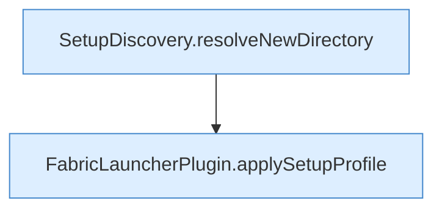

[[00 Start]] › [[Plugin-Kern]] › [[Setup]] › [[Setup-Dialog]] › [[FabricLauncherPlugin.configureSetup]] › [[FabricLauncherPlugin.configureSetup.Teil2.Z519.Z530.Z535.Z538.Teil2]]

# FabricLauncherPlugin.configureSetup.Teil2.Z519.Z530.Z535.Z538.Teil2



```knoten
SetupDiscovery.resolveNewDirectory
  Dieser Teil bestimmt hier einen Schritt. Eine Ebene tiefer steht er genauer. Löst auf `resolveNewDirectory`.
FabricLauncherPlugin.applySetupProfile
  Das [[Glossar#Plugin|Plugin]] wendet an die [[Glossar#Einrichtung|Einrichtung]] die Beschreibung. Wendet an `applySetupProfile`.
```

> [!knoten]- Was die Blöcke tun
> - **SetupDiscovery.resolveNewDirectory**: Dieser Teil bestimmt hier einen Schritt. Eine Ebene tiefer steht er genauer. Löst auf `resolveNewDirectory`.
> - **FabricLauncherPlugin.applySetupProfile**: Das [[Glossar#Plugin|Plugin]] wendet an die [[Glossar#Einrichtung|Einrichtung]] die Beschreibung. Wendet an `applySetupProfile`.

- Ein weiterer Abschnitt derselben Übersicht.
- Fortsetzung von `FabricLauncherPlugin.configureSetup.Teil2.Z519.Z530.Z535.Z538`.
