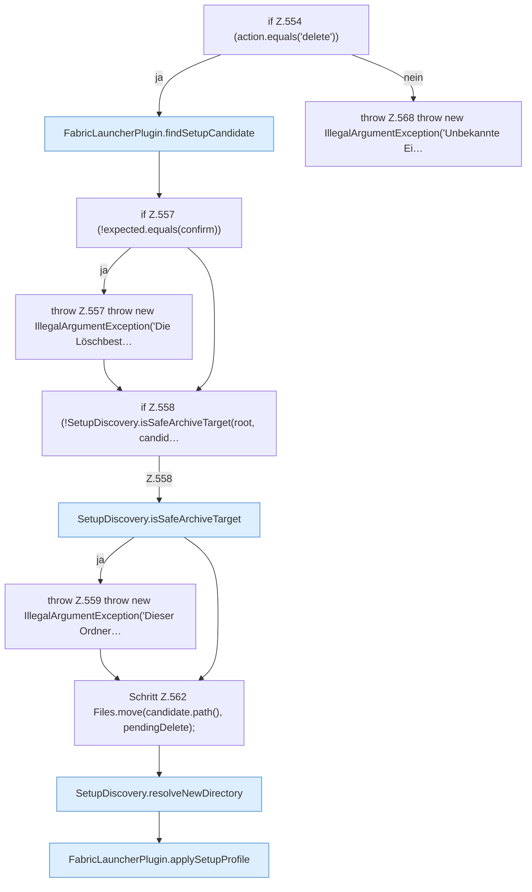

[[00 Start]] › [[Plugin-Kern]] › [[Setup]] › [[Setup-Dialog]] › [[FabricLauncherPlugin.configureSetup]] › [[FabricLauncherPlugin.configureSetup.Teil2.Z519.Z530.Z535.Z538.Z554]]

# FabricLauncherPlugin.configureSetup.Teil2.Z519.Z530.Z535.Z538.Z554



```knoten
if Z.554 (action.equals('delete'))
  Zeile 554: prüft `(action.equals('delete'))`.
FabricLauncherPlugin.findSetupCandidate
  Das [[Glossar#Plugin|Plugin]] sucht die [[Glossar#Einrichtung|Einrichtung]]. Sucht `findSetupCandidate`. Ruft `scan`.
if Z.557 (!expected.equals(confirm))
  Zeile 557: prüft `(!expected.equals(confirm))`.
throw Z.557 throw new IllegalArgumentException('Die Löschbest…
  Zeile 557: Abbruch `throw new IllegalArgumentException('Die Löschbest…`.
if Z.558 (!SetupDiscovery.isSafeArchiveTarget(root, candid…
  Zeile 558: prüft `(!SetupDiscovery.isSafeArchiveTarget(root, candid…`.
SetupDiscovery.isSafeArchiveTarget
  Dieser Teil prüft die erlaubte Grenze. Prüft `isSafeArchiveTarget`.
throw Z.559 throw new IllegalArgumentException('Dieser Ordner…
  Zeile 559: Abbruch `throw new IllegalArgumentException('Dieser Ordner…`.
Schritt Z.562 Files.move(candidate.path(), pendingDelete);
  Zeile 562: Dateioperation. `Files.move(candidate.path(), pendingDelete);`
SetupDiscovery.resolveNewDirectory
  Dieser Teil bestimmt hier einen Schritt. Eine Ebene tiefer steht er genauer. Löst auf `resolveNewDirectory`.
FabricLauncherPlugin.applySetupProfile
  Das [[Glossar#Plugin|Plugin]] wendet an die [[Glossar#Einrichtung|Einrichtung]] die Beschreibung. Wendet an `applySetupProfile`.
throw Z.568 throw new IllegalArgumentException('Unbekannte Ei…
  Zeile 568: Abbruch `throw new IllegalArgumentException('Unbekannte Ei…`.
```

> [!knoten]- Was die Blöcke tun
> - **if Z.554 (action.equals('delete'))**: Zeile 554: prüft `(action.equals('delete'))`.
> - **FabricLauncherPlugin.findSetupCandidate**: Das [[Glossar#Plugin|Plugin]] sucht die [[Glossar#Einrichtung|Einrichtung]]. Sucht `findSetupCandidate`. Ruft `scan`.
> - **if Z.557 (!expected.equals(confirm))**: Zeile 557: prüft `(!expected.equals(confirm))`.
> - **throw Z.557 throw new IllegalArgumentException('Die Löschbest…**: Zeile 557: Abbruch `throw new IllegalArgumentException('Die Löschbest…`.
> - **if Z.558 (!SetupDiscovery.isSafeArchiveTarget(root, candid…**: Zeile 558: prüft `(!SetupDiscovery.isSafeArchiveTarget(root, candid…`.
> - **SetupDiscovery.isSafeArchiveTarget**: Dieser Teil prüft die erlaubte Grenze. Prüft `isSafeArchiveTarget`.
> - **throw Z.559 throw new IllegalArgumentException('Dieser Ordner…**: Zeile 559: Abbruch `throw new IllegalArgumentException('Dieser Ordner…`.
> - **Schritt Z.562 Files.move(candidate.path(), pendingDelete);**: Zeile 562: Dateioperation. `Files.move(candidate.path(), pendingDelete);`
> - **SetupDiscovery.resolveNewDirectory**: Dieser Teil bestimmt hier einen Schritt. Eine Ebene tiefer steht er genauer. Löst auf `resolveNewDirectory`.
> - **FabricLauncherPlugin.applySetupProfile**: Das [[Glossar#Plugin|Plugin]] wendet an die [[Glossar#Einrichtung|Einrichtung]] die Beschreibung. Wendet an `applySetupProfile`.
> - **throw Z.568 throw new IllegalArgumentException('Unbekannte Ei…**: Zeile 568: Abbruch `throw new IllegalArgumentException('Unbekannte Ei…`.

- Der Ablauf geht in [[Glossar#Zeile|Zeile]] 554 weiter. Eine Ebene tiefer steht er genauer.
- Fortsetzung von `FabricLauncherPlugin.configureSetup.Teil2.Z519.Z530.Z535.Z538`.
