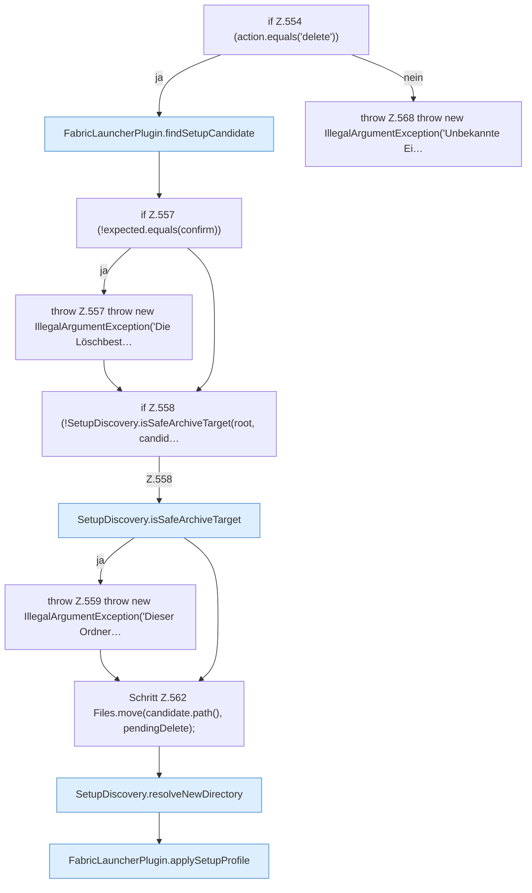

[[00 Start]] › [[Plugin-Kern]] › [[Setup]] › [[Setup-Dialog]] › [[FabricLauncherPlugin.configureSetup]] › [[FabricLauncherPlugin.configureSetup.Teil2.Z519.Z530.Z535.Z538.Z554]]

# FabricLauncherPlugin.configureSetup.Teil2.Z519.Z530.Z535.Z538.Z554

- Fortsetzung von `FabricLauncherPlugin.configureSetup.Teil2.Z519.Z530.Z535.Z538`, Quellreihenfolge.
