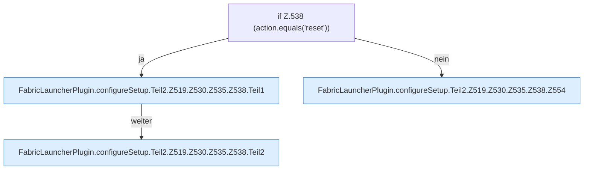

[[00 Start]] › [[Plugin-Kern]] › [[Setup]] › [[Setup-Dialog]] › [[FabricLauncherPlugin.configureSetup]] › [[FabricLauncherPlugin.configureSetup.Teil2.Z519.Z530.Z535.Z538]]

# FabricLauncherPlugin.configureSetup.Teil2.Z519.Z530.Z535.Z538



```knoten
if Z.538 (action.equals('reset'))
  Zeile 538: prüft `(action.equals('reset'))`.
FabricLauncherPlugin.configureSetup.Teil2.Z519.Z530.Z535.Z538.Teil1
  Abschnitt 1 dieses Ablaufs, in Quellreihenfolge.
FabricLauncherPlugin.configureSetup.Teil2.Z519.Z530.Z535.Z538.Teil2
  Abschnitt 2 dieses Ablaufs, in Quellreihenfolge.
FabricLauncherPlugin.configureSetup.Teil2.Z519.Z530.Z535.Z538.Z554
  Fortsetzung des Ablaufs ab Zeile 554.
```

- Fortsetzung von `FabricLauncherPlugin.configureSetup.Teil2.Z519.Z530.Z535`, Quellreihenfolge.
