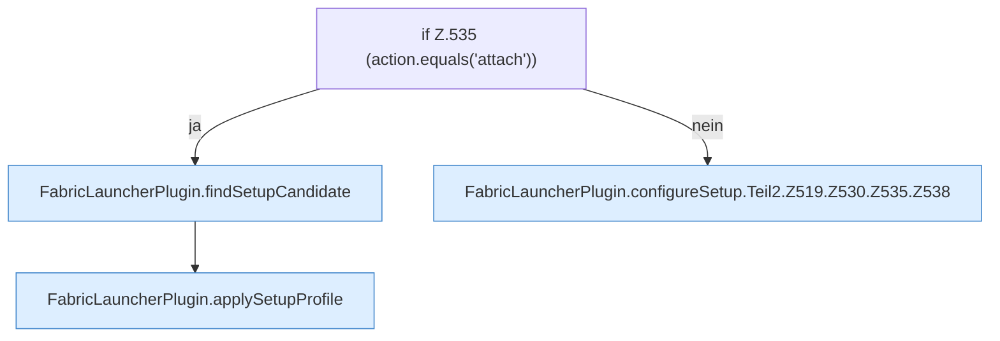

[[00 Start]] › [[Plugin-Kern]] › [[Setup]] › [[Setup-Dialog]] › [[FabricLauncherPlugin.configureSetup]] › [[FabricLauncherPlugin.configureSetup.Teil2.Z519.Z530.Z535]]

# FabricLauncherPlugin.configureSetup.Teil2.Z519.Z530.Z535



```knoten
if Z.535 (action.equals('attach'))
  Zeile 535: prüft `(action.equals('attach'))`.
FabricLauncherPlugin.findSetupCandidate
  Das [[Glossar#Plugin|Plugin]] sucht die [[Glossar#Einrichtung|Einrichtung]]. Sucht `findSetupCandidate`. Ruft `scan`.
FabricLauncherPlugin.applySetupProfile
  Das [[Glossar#Plugin|Plugin]] wendet an die [[Glossar#Einrichtung|Einrichtung]] die Beschreibung. Wendet an `applySetupProfile`.
FabricLauncherPlugin.configureSetup.Teil2.Z519.Z530.Z535.Z538
  Der Ablauf geht in [[Glossar#Zeile|Zeile]] 538 weiter. Eine Ebene tiefer steht er genauer. Fortsetzung des Ablaufs ab Zeile 538.
```

> [!knoten]- Was die Blöcke tun
> - **if Z.535 (action.equals('attach'))**: Zeile 535: prüft `(action.equals('attach'))`.
> - **FabricLauncherPlugin.findSetupCandidate**: Das [[Glossar#Plugin|Plugin]] sucht die [[Glossar#Einrichtung|Einrichtung]]. Sucht `findSetupCandidate`. Ruft `scan`.
> - **FabricLauncherPlugin.applySetupProfile**: Das [[Glossar#Plugin|Plugin]] wendet an die [[Glossar#Einrichtung|Einrichtung]] die Beschreibung. Wendet an `applySetupProfile`.
> - **FabricLauncherPlugin.configureSetup.Teil2.Z519.Z530.Z535.Z538**: Der Ablauf geht in [[Glossar#Zeile|Zeile]] 538 weiter. Eine Ebene tiefer steht er genauer. Fortsetzung des Ablaufs ab Zeile 538.

- Der Ablauf geht in [[Glossar#Zeile|Zeile]] 535 weiter. Eine Ebene tiefer steht er genauer.
- Fortsetzung von `FabricLauncherPlugin.configureSetup.Teil2.Z519.Z530`.
