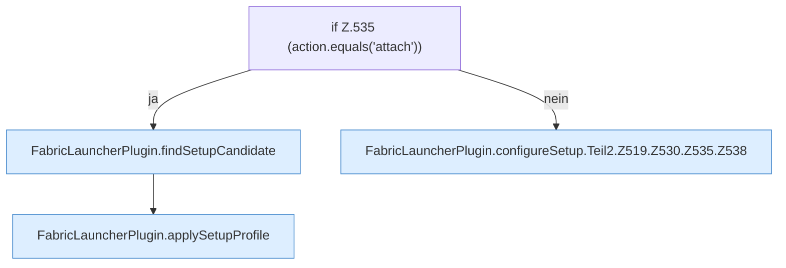

[[00 Start]] › [[Plugin-Kern]] › [[Setup]] › [[Setup-Dialog]] › [[FabricLauncherPlugin.configureSetup]] › [[FabricLauncherPlugin.configureSetup.Teil2.Z519.Z530.Z535]]

# FabricLauncherPlugin.configureSetup.Teil2.Z519.Z530.Z535



```knoten
if Z.535 (action.equals('attach'))
  Zeile 535: prüft `(action.equals('attach'))`.
FabricLauncherPlugin.findSetupCandidate
  Sucht `findSetupCandidate`. Ruft `scan`.
FabricLauncherPlugin.applySetupProfile
  Wendet an `applySetupProfile`.
FabricLauncherPlugin.configureSetup.Teil2.Z519.Z530.Z535.Z538
  Fortsetzung des Ablaufs ab Zeile 538.
```

- Fortsetzung von `FabricLauncherPlugin.configureSetup.Teil2.Z519.Z530`, Quellreihenfolge.
