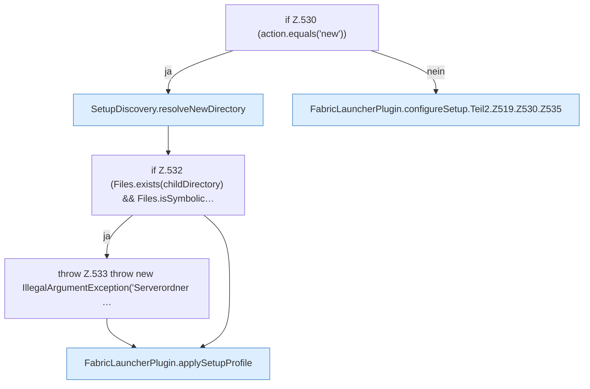

[[00 Start]] › [[Plugin-Kern]] › [[Setup]] › [[Setup-Dialog]] › [[FabricLauncherPlugin.configureSetup]] › [[FabricLauncherPlugin.configureSetup.Teil2.Z519.Z530]]

# FabricLauncherPlugin.configureSetup.Teil2.Z519.Z530



```knoten
if Z.530 (action.equals('new'))
  Zeile 530: prüft `(action.equals('new'))`.
SetupDiscovery.resolveNewDirectory
  Löst auf `resolveNewDirectory`.
if Z.532 (Files.exists(childDirectory) && Files.isSymbolic…
  Zeile 532: prüft `(Files.exists(childDirectory) && Files.isSymbolic…`.
throw Z.533 throw new IllegalArgumentException('Serverordner …
  Zeile 533: Abbruch `throw new IllegalArgumentException('Serverordner …`.
FabricLauncherPlugin.applySetupProfile
  Wendet an `applySetupProfile`.
FabricLauncherPlugin.configureSetup.Teil2.Z519.Z530.Z535
  Fortsetzung des Ablaufs ab Zeile 535.
```

- Fortsetzung von `FabricLauncherPlugin.configureSetup.Teil2.Z519`, Quellreihenfolge.
