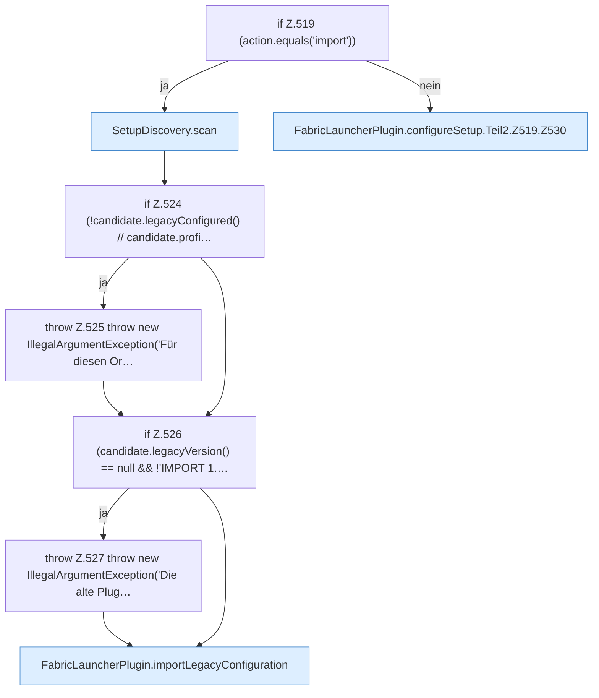

[[00 Start]] › [[Plugin-Kern]] › [[Setup]] › [[Setup-Dialog]] › [[FabricLauncherPlugin.configureSetup]] › [[FabricLauncherPlugin.configureSetup.Teil2.Z519]]

# FabricLauncherPlugin.configureSetup.Teil2.Z519

- Fortsetzung von `FabricLauncherPlugin.configureSetup.Teil2`, Quellreihenfolge.
