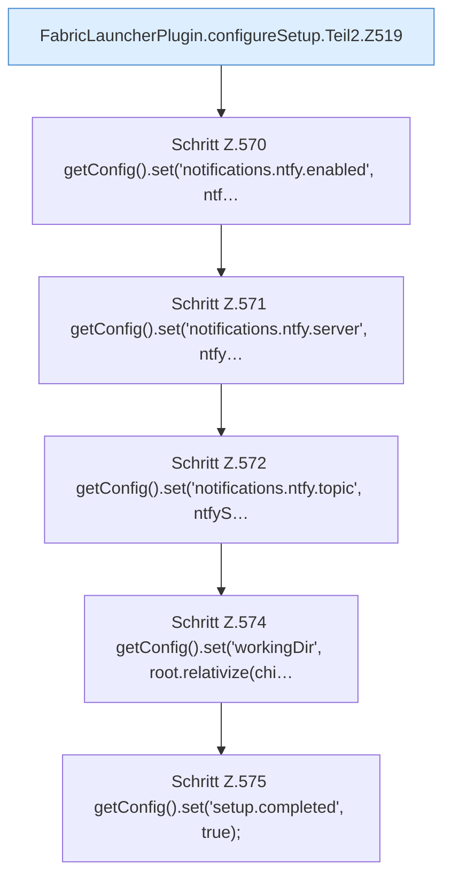

[[00 Start]] › [[Plugin-Kern]] › [[Setup]] › [[Setup-Dialog]] › [[FabricLauncherPlugin.configureSetup]] › [[FabricLauncherPlugin.configureSetup.Teil2]]

# FabricLauncherPlugin.configureSetup.Teil2

- Fortsetzung von `FabricLauncherPlugin.configureSetup`, Quellreihenfolge.
