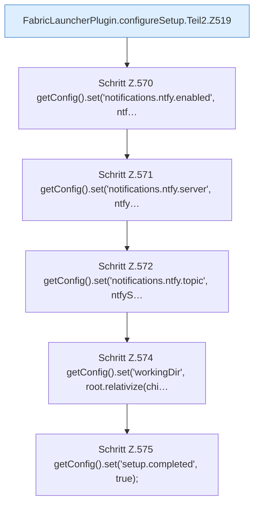

[[00 Start]] › [[Plugin-Kern]] › [[Setup]] › [[Setup-Dialog]] › [[FabricLauncherPlugin.configureSetup]] › [[FabricLauncherPlugin.configureSetup.Teil2]]

# FabricLauncherPlugin.configureSetup.Teil2



```knoten
FabricLauncherPlugin.configureSetup.Teil2.Z519
  Fortsetzung des Ablaufs ab Zeile 519.
Schritt Z.570 getConfig().set('notifications.ntfy.enabled', ntf…
  Zeile 570: liest die Config. `getConfig().set('notifications.ntfy.enabled', ntf…`
Schritt Z.571 getConfig().set('notifications.ntfy.server', ntfy…
  Zeile 571: liest die Config. `getConfig().set('notifications.ntfy.server', ntfy…`
Schritt Z.572 getConfig().set('notifications.ntfy.topic', ntfyS…
  Zeile 572: liest die Config. `getConfig().set('notifications.ntfy.topic', ntfyS…`
Schritt Z.574 getConfig().set('workingDir', root.relativize(chi…
  Zeile 574: liest die Config. `getConfig().set('workingDir', root.relativize(chi…`
Schritt Z.575 getConfig().set('setup.completed', true);
  Zeile 575: liest die Config. `getConfig().set('setup.completed', true);`
```

- Fortsetzung von `FabricLauncherPlugin.configureSetup`, Quellreihenfolge.
