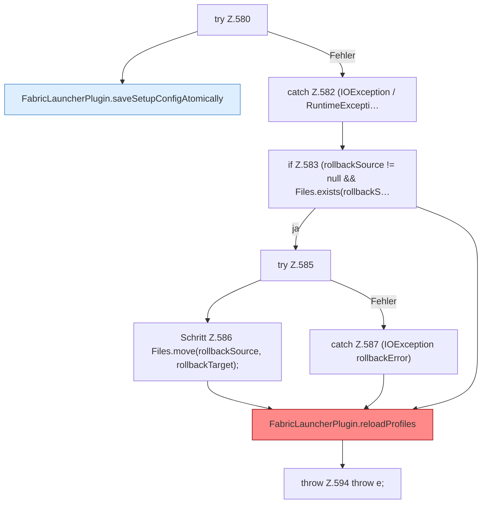

[[00 Start]] › [[Plugin-Kern]] › [[Setup]] › [[Setup-Dialog]] › [[FabricLauncherPlugin.configureSetup]] › [[FabricLauncherPlugin.configureSetup.Teil3.Z580]]

# FabricLauncherPlugin.configureSetup.Teil3.Z580

- Fortsetzung von `FabricLauncherPlugin.configureSetup.Teil3`, Quellreihenfolge.
