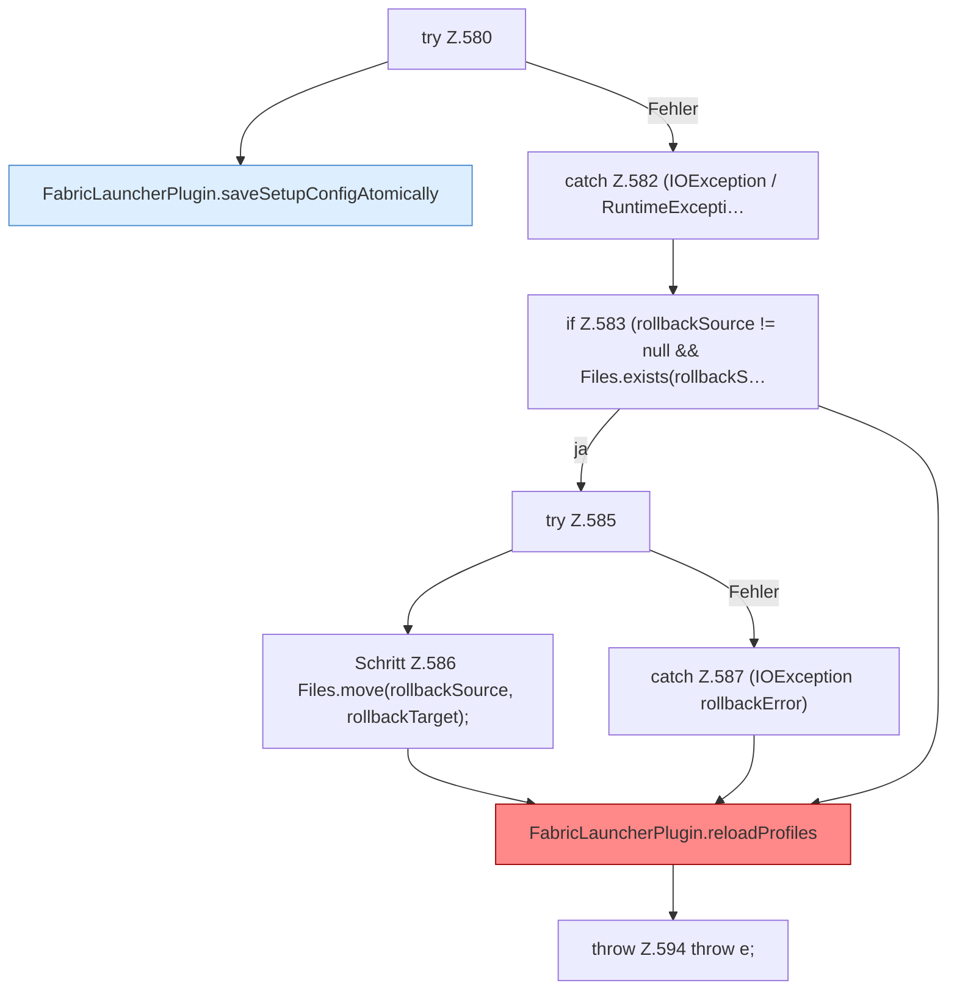

[[00 Start]] › [[Plugin-Kern]] › [[Setup]] › [[Setup-Dialog]] › [[FabricLauncherPlugin.configureSetup]] › [[FabricLauncherPlugin.configureSetup.Teil3.Z580]]

# FabricLauncherPlugin.configureSetup.Teil3.Z580



```knoten
try Z.580
  Zeile 580: Versuch. Der Fehlerpfad geht in catch.
FabricLauncherPlugin.saveSetupConfigAtomically
  Speichert `saveSetupConfigAtomically`. Ruft `makeWritable`.
catch Z.582 (IOException / RuntimeExcepti…
  Zeile 582: fängt (IOException / RuntimeExcepti….
if Z.583 (rollbackSource != null && Files.exists(rollbackS…
  Zeile 583: prüft `(rollbackSource != null && Files.exists(rollbackS…`.
try Z.585
  Zeile 585: Versuch. Der Fehlerpfad geht in catch.
Schritt Z.586 Files.move(rollbackSource, rollbackTarget);
  Zeile 586: Dateioperation. `Files.move(rollbackSource, rollbackTarget);`
catch Z.587 (IOException rollbackError)
  Zeile 587: fängt (IOException rollbackError).
FabricLauncherPlugin.reloadProfiles
  `Profiles.load`, danach nur `getFirst()`. Befund: angemeldet aber nicht umgesetzt (sicher).
throw Z.594 throw e;
  Zeile 594: Abbruch `throw e;`.
```

- Fortsetzung von `FabricLauncherPlugin.configureSetup.Teil3`, Quellreihenfolge.
