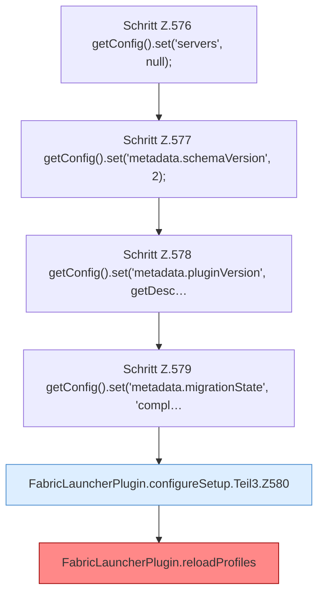

[[00 Start]] › [[Plugin-Kern]] › [[Setup]] › [[Setup-Dialog]] › [[FabricLauncherPlugin.configureSetup]] › [[FabricLauncherPlugin.configureSetup.Teil3]]

# FabricLauncherPlugin.configureSetup.Teil3



```knoten
Schritt Z.576 getConfig().set('servers', null);
  Zeile 576: liest die Config. `getConfig().set('servers', null);`
Schritt Z.577 getConfig().set('metadata.schemaVersion', 2);
  Zeile 577: liest die Config. `getConfig().set('metadata.schemaVersion', 2);`
Schritt Z.578 getConfig().set('metadata.pluginVersion', getDesc…
  Zeile 578: liest die Config. `getConfig().set('metadata.pluginVersion', getDesc…`
Schritt Z.579 getConfig().set('metadata.migrationState', 'compl…
  Zeile 579: liest die Config. `getConfig().set('metadata.migrationState', 'compl…`
FabricLauncherPlugin.configureSetup.Teil3.Z580
  Fortsetzung des Ablaufs ab Zeile 580.
FabricLauncherPlugin.reloadProfiles
  `Profiles.load`, danach nur `getFirst()`. Befund: angemeldet aber nicht umgesetzt (sicher).
```

- Fortsetzung von `FabricLauncherPlugin.configureSetup`, Quellreihenfolge.
