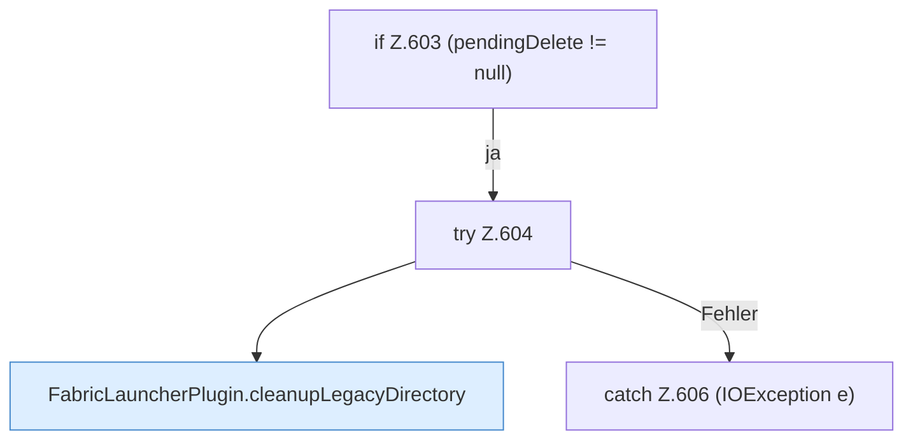

[[00 Start]] › [[Plugin-Kern]] › [[Setup]] › [[Setup-Dialog]] › [[FabricLauncherPlugin.configureSetup]] › [[FabricLauncherPlugin.configureSetup.Teil4.Z603]]

# FabricLauncherPlugin.configureSetup.Teil4.Z603

- Fortsetzung von `FabricLauncherPlugin.configureSetup.Teil4`, Quellreihenfolge.
