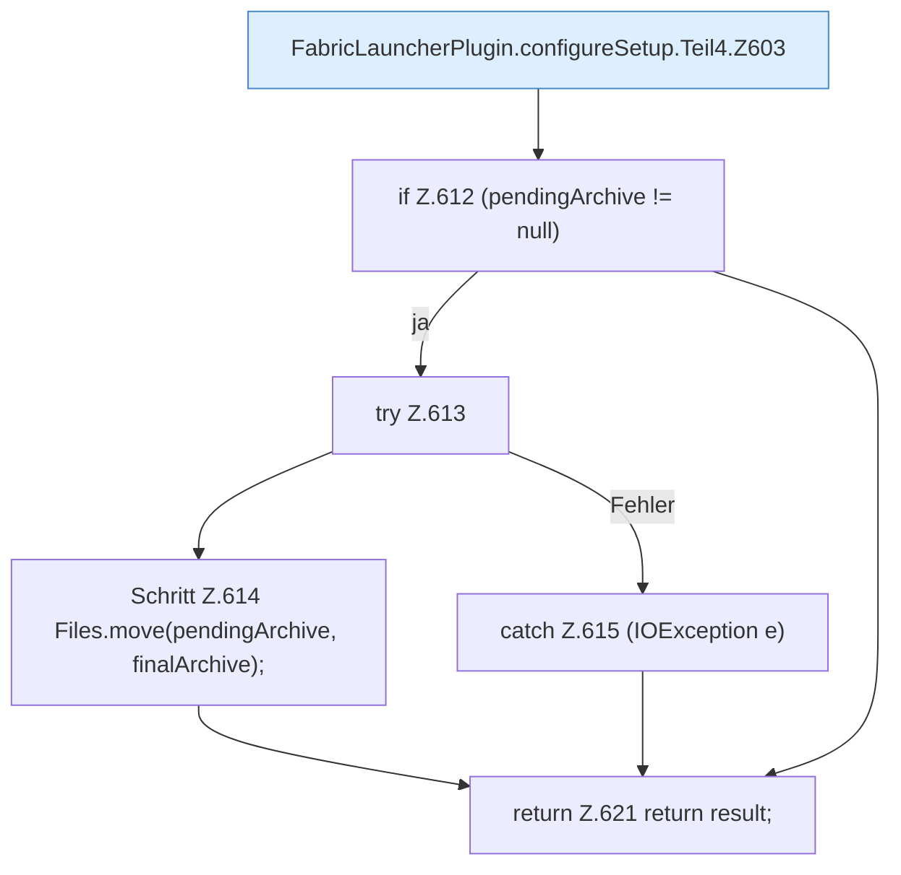

[[00 Start]] › [[Plugin-Kern]] › [[Setup]] › [[Setup-Dialog]] › [[FabricLauncherPlugin.configureSetup]] › [[FabricLauncherPlugin.configureSetup.Teil4]]

# FabricLauncherPlugin.configureSetup.Teil4

- Fortsetzung von `FabricLauncherPlugin.configureSetup`, Quellreihenfolge.
