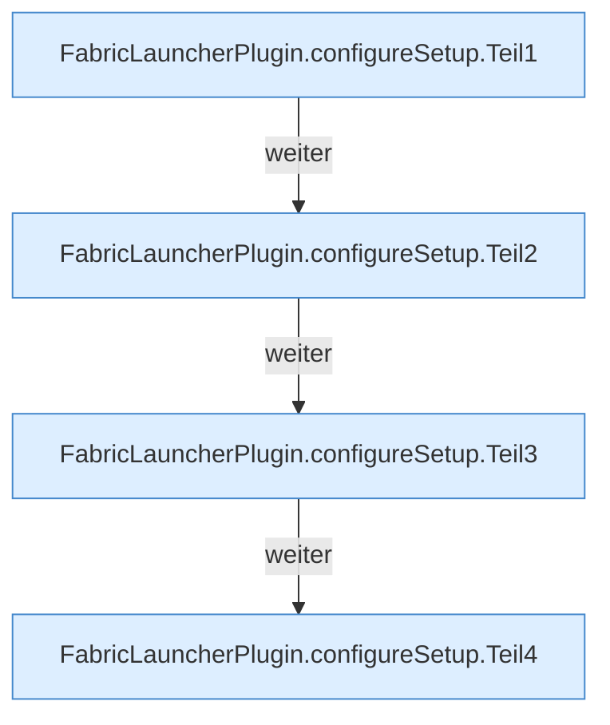

[[00 Start]] › [[Plugin-Kern]] › [[Setup]] › [[Setup-Dialog]] › [[FabricLauncherPlugin.configureSetup]]

# FabricLauncherPlugin.configureSetup

`FabricLauncherPlugin.configureSetup(String action, String path, String type, String mcVersion, int port, String confirm, boolean ntfyEnabled, String ntfyServer, String ntfyTopic)` [src/main/java/de/aichele/childlauncher/FabricLauncherPlugin.java:501–622](https://github.com/Sciddie/minecraft-serverhoster-plugin/blob/95b02b953b0b4c23673e900e021a7c3c844aa37d/src/main/java/de/aichele/childlauncher/FabricLauncherPlugin.java#L501-L622)



```knoten
FabricLauncherPlugin.configureSetup.Teil1
  Ein weiterer Abschnitt derselben Übersicht. Abschnitt 1 dieses Ablaufs, in Quellreihenfolge.
FabricLauncherPlugin.configureSetup.Teil2
  Ein weiterer Abschnitt derselben Übersicht. Abschnitt 2 dieses Ablaufs, in Quellreihenfolge.
FabricLauncherPlugin.configureSetup.Teil3
  Ein weiterer Abschnitt derselben Übersicht. Abschnitt 3 dieses Ablaufs, in Quellreihenfolge.
FabricLauncherPlugin.configureSetup.Teil4
  Ein weiterer Abschnitt derselben Übersicht. Abschnitt 4 dieses Ablaufs, in Quellreihenfolge.
```

> [!knoten]- Was die Blöcke tun
> - **FabricLauncherPlugin.configureSetup.Teil1**: Ein weiterer Abschnitt derselben Übersicht. Abschnitt 1 dieses Ablaufs, in Quellreihenfolge.
> - **FabricLauncherPlugin.configureSetup.Teil2**: Ein weiterer Abschnitt derselben Übersicht. Abschnitt 2 dieses Ablaufs, in Quellreihenfolge.
> - **FabricLauncherPlugin.configureSetup.Teil3**: Ein weiterer Abschnitt derselben Übersicht. Abschnitt 3 dieses Ablaufs, in Quellreihenfolge.
> - **FabricLauncherPlugin.configureSetup.Teil4**: Ein weiterer Abschnitt derselben Übersicht. Abschnitt 4 dieses Ablaufs, in Quellreihenfolge.

- Das [[Glossar#Plugin|Plugin]] kümmert sich um die [[Glossar#Einrichtung|Einrichtung]].
- `configureSetup` in `src/main/java/de/aichele/childlauncher/FabricLauncherPlugin.java`
