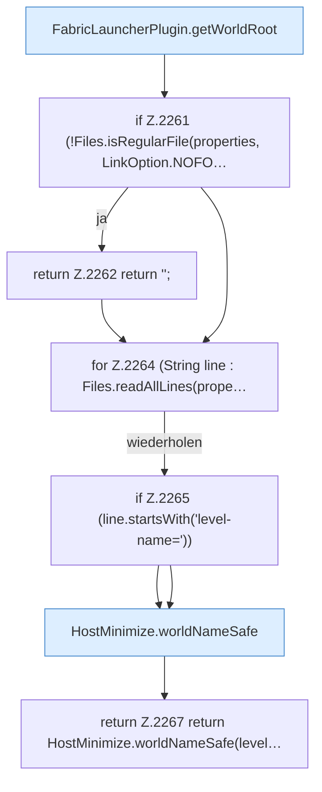

[[00 Start]] › [[Plugin-Kern]] › [[Host-Pfade]] › [[FabricLauncherPlugin.configuredHostWorld]]

# FabricLauncherPlugin.configuredHostWorld

`FabricLauncherPlugin.configuredHostWorld()` [src/main/java/de/aichele/childlauncher/FabricLauncherPlugin.java:2259–2268](https://github.com/Sciddie/minecraft-serverhoster-plugin/blob/95b02b953b0b4c23673e900e021a7c3c844aa37d/src/main/java/de/aichele/childlauncher/FabricLauncherPlugin.java#L2259-L2268)



```knoten
FabricLauncherPlugin.getWorldRoot
  Das [[Glossar#Plugin|Plugin]] liefert die [[Glossar#Spielwelt|Spielwelt]] den Anfang. Im [[Glossar#Quelltext|Quelltext]] heißt das `getWorldRoot`.
if Z.2261 (!Files.isRegularFile(properties, LinkOption.NOFO…
  Hier fällt eine Entscheidung. Nur wenn sie zutrifft, geht es den Ja-Weg weiter. Das steht in [[Glossar#Zeile|Zeile]] 2261.
return Z.2262 return '';
  Hier endet die [[Glossar#Funktion|Funktion]] und liefert ein Ergebnis zurück. Das steht in [[Glossar#Zeile|Zeile]] 2262.
for Z.2264 (String line : Files.readAllLines(prope…
  Dasselbe wird für jeden Eintrag wiederholt. Das steht in [[Glossar#Zeile|Zeile]] 2264.
if Z.2265 (line.startsWith('level-name='))
  Hier fällt eine Entscheidung. Nur wenn sie zutrifft, geht es den Ja-Weg weiter. Das steht in [[Glossar#Zeile|Zeile]] 2265.
HostMinimize.worldNameSafe
  Das Verkleinern des [[Glossar#Host|Host]] kümmert sich um den Namen die erlaubte Grenze. Im [[Glossar#Quelltext|Quelltext]] heißt das `worldNameSafe`.
return Z.2267 return HostMinimize.worldNameSafe(level…
  Hier endet die [[Glossar#Funktion|Funktion]] und liefert ein Ergebnis zurück. Das steht in [[Glossar#Zeile|Zeile]] 2267.
```

> [!knoten]- Was die Blöcke tun
> - **FabricLauncherPlugin.getWorldRoot**: Das [[Glossar#Plugin|Plugin]] liefert die [[Glossar#Spielwelt|Spielwelt]] den Anfang. Im [[Glossar#Quelltext|Quelltext]] heißt das `getWorldRoot`.
> - **if Z.2261 (!Files.isRegularFile(properties, LinkOption.NOFO…**: Hier fällt eine Entscheidung. Nur wenn sie zutrifft, geht es den Ja-Weg weiter. Das steht in [[Glossar#Zeile|Zeile]] 2261.
> - **return Z.2262 return '';**: Hier endet die [[Glossar#Funktion|Funktion]] und liefert ein Ergebnis zurück. Das steht in [[Glossar#Zeile|Zeile]] 2262.
> - **for Z.2264 (String line : Files.readAllLines(prope…**: Dasselbe wird für jeden Eintrag wiederholt. Das steht in [[Glossar#Zeile|Zeile]] 2264.
> - **if Z.2265 (line.startsWith('level-name='))**: Hier fällt eine Entscheidung. Nur wenn sie zutrifft, geht es den Ja-Weg weiter. Das steht in [[Glossar#Zeile|Zeile]] 2265.
> - **HostMinimize.worldNameSafe**: Das Verkleinern des [[Glossar#Host|Host]] kümmert sich um den Namen die erlaubte Grenze. Im [[Glossar#Quelltext|Quelltext]] heißt das `worldNameSafe`.
> - **return Z.2267 return HostMinimize.worldNameSafe(level…**: Hier endet die [[Glossar#Funktion|Funktion]] und liefert ein Ergebnis zurück. Das steht in [[Glossar#Zeile|Zeile]] 2267.

- Liest, welche [[Glossar#Spielwelt|Spielwelt]] der [[Glossar#Host|Host]] benutzen soll.
