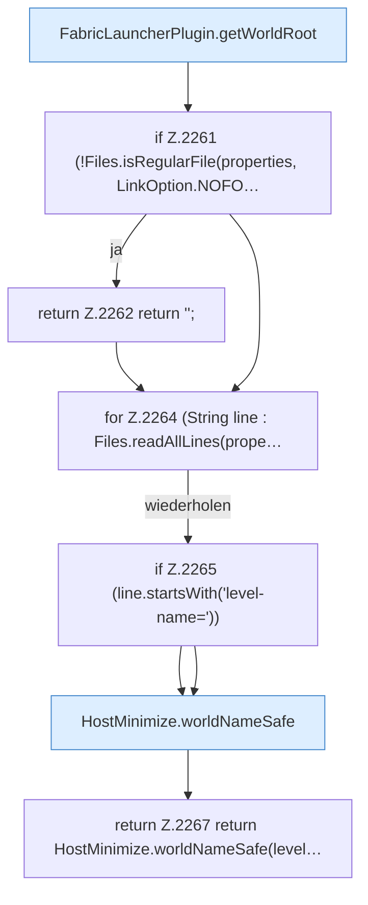

[[00 Start]] › [[Plugin-Kern]] › [[Host-Pfade]] › [[FabricLauncherPlugin.configuredHostWorld]]

# FabricLauncherPlugin.configuredHostWorld

`FabricLauncherPlugin.configuredHostWorld()` [src/main/java/de/aichele/childlauncher/FabricLauncherPlugin.java:2259–2268](https://github.com/Sciddie/minecraft-serverhoster-plugin/blob/95b02b953b0b4c23673e900e021a7c3c844aa37d/src/main/java/de/aichele/childlauncher/FabricLauncherPlugin.java#L2259-L2268)

- `configuredHostWorld` in `src/main/java/de/aichele/childlauncher/FabricLauncherPlugin.java`
