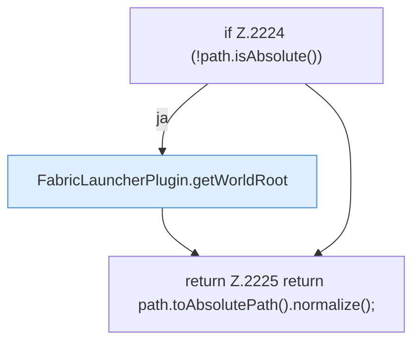

[[00 Start]] › [[Plugin-Kern]] › [[Host-Pfade]] › [[FabricLauncherPlugin.configuredPath]]

# FabricLauncherPlugin.configuredPath

`FabricLauncherPlugin.configuredPath(String configured)` [src/main/java/de/aichele/childlauncher/FabricLauncherPlugin.java:2222–2226](https://github.com/Sciddie/minecraft-serverhoster-plugin/blob/95b02b953b0b4c23673e900e021a7c3c844aa37d/src/main/java/de/aichele/childlauncher/FabricLauncherPlugin.java#L2222-L2226)



```knoten
if Z.2224 (!path.isAbsolute())
  Hier fällt eine Entscheidung. Nur wenn sie zutrifft, geht es den Ja-Weg weiter. Das steht in [[Glossar#Zeile|Zeile]] 2224.
FabricLauncherPlugin.getWorldRoot
  Das [[Glossar#Plugin|Plugin]] liefert die [[Glossar#Spielwelt|Spielwelt]] den Anfang. Im [[Glossar#Quelltext|Quelltext]] heißt das `getWorldRoot`.
return Z.2225 return path.toAbsolutePath().normalize();
  Hier endet die [[Glossar#Funktion|Funktion]] und liefert ein Ergebnis zurück. Das steht in [[Glossar#Zeile|Zeile]] 2225.
```

> [!knoten]- Was die Blöcke tun
> - **if Z.2224 (!path.isAbsolute())**: Hier fällt eine Entscheidung. Nur wenn sie zutrifft, geht es den Ja-Weg weiter. Das steht in [[Glossar#Zeile|Zeile]] 2224.
> - **FabricLauncherPlugin.getWorldRoot**: Das [[Glossar#Plugin|Plugin]] liefert die [[Glossar#Spielwelt|Spielwelt]] den Anfang. Im [[Glossar#Quelltext|Quelltext]] heißt das `getWorldRoot`.
> - **return Z.2225 return path.toAbsolutePath().normalize();**: Hier endet die [[Glossar#Funktion|Funktion]] und liefert ein Ergebnis zurück. Das steht in [[Glossar#Zeile|Zeile]] 2225.

- Liest einen Ordner so, wie er in den [[Glossar#Einstellungen|Einstellungen]] steht.
