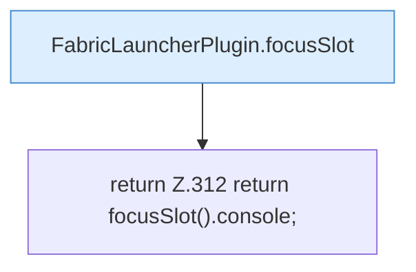

[[00 Start]] › [[Plugin-Kern]] › [[Slot-Status]] › [[FabricLauncherPlugin.console()]]

# FabricLauncherPlugin.console()

`FabricLauncherPlugin.console()` [src/main/java/de/aichele/childlauncher/FabricLauncherPlugin.java:312–312](https://github.com/Sciddie/minecraft-serverhoster-plugin/blob/95b02b953b0b4c23673e900e021a7c3c844aa37d/src/main/java/de/aichele/childlauncher/FabricLauncherPlugin.java#L312-L312)



```knoten
FabricLauncherPlugin.focusSlot
  Liefert oder setzt den Fokus `focusSlot`. Ruft `slot`.
return Z.312 return focusSlot().console;
  Zeile 312: Rückgabe `return focusSlot().console;`.
```

- `console` in `src/main/java/de/aichele/childlauncher/FabricLauncherPlugin.java`
- Befund: toter Code, prüfen. src/main/java/de/aichele/childlauncher/FabricLauncherPlugin.java:312–312 kein Produktionsaufruf im Aufrufgraph; Name kommt in UI, Config oder anderem Text vor
