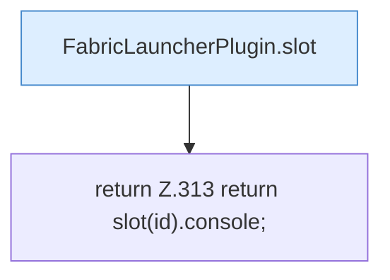

[[00 Start]] › [[Plugin-Kern]] › [[Slot-Status]] › [[FabricLauncherPlugin.console(String)]]

# FabricLauncherPlugin.console(String)

`FabricLauncherPlugin.console(String id)` [src/main/java/de/aichele/childlauncher/FabricLauncherPlugin.java:313–313](https://github.com/Sciddie/minecraft-serverhoster-plugin/blob/95b02b953b0b4c23673e900e021a7c3c844aa37d/src/main/java/de/aichele/childlauncher/FabricLauncherPlugin.java#L313-L313)



```knoten
FabricLauncherPlugin.slot
  Das [[Glossar#Plugin|Plugin]] macht hier einen einzelnen Schritt. Eine Ebene tiefer steht er genauer. Im [[Glossar#Quelltext|Quelltext]] heißt das `slot`.
return Z.313 return slot(id).console;
  Hier endet die [[Glossar#Funktion|Funktion]] und liefert ein Ergebnis zurück. Das steht in [[Glossar#Zeile|Zeile]] 313.
```

> [!knoten]- Was die Blöcke tun
> - **FabricLauncherPlugin.slot**: Das [[Glossar#Plugin|Plugin]] macht hier einen einzelnen Schritt. Eine Ebene tiefer steht er genauer. Im [[Glossar#Quelltext|Quelltext]] heißt das `slot`.
> - **return Z.313 return slot(id).console;**: Hier endet die [[Glossar#Funktion|Funktion]] und liefert ein Ergebnis zurück. Das steht in [[Glossar#Zeile|Zeile]] 313.

- Liefert die letzten [[Glossar#Zeile|Zeilen]] der [[Glossar#Konsole|Konsole]].
