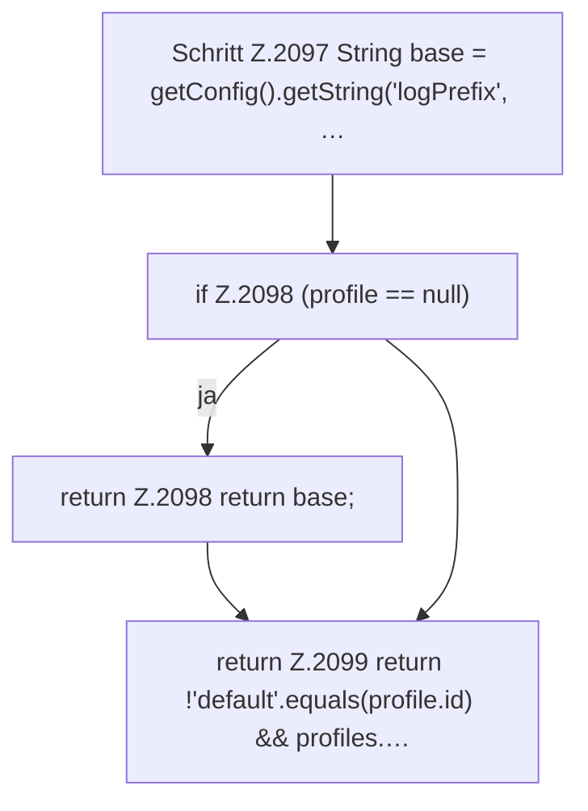

[[00 Start]] › [[Child-Prozess]] › [[Startablauf]] › [[FabricLauncherPlugin.consolePrefix]]

# FabricLauncherPlugin.consolePrefix

`FabricLauncherPlugin.consolePrefix(ServerProfile profile)` [src/main/java/de/aichele/childlauncher/FabricLauncherPlugin.java:2096–2100](https://github.com/Sciddie/minecraft-serverhoster-plugin/blob/95b02b953b0b4c23673e900e021a7c3c844aa37d/src/main/java/de/aichele/childlauncher/FabricLauncherPlugin.java#L2096-L2100)



```knoten
Schritt Z.2097 String base = getConfig().getString('logPrefix', …
  Ein einzelner Arbeitsschritt, ohne eine weitere eigene [[Glossar#Funktion|Funktion]] aufzurufen. Das steht in [[Glossar#Zeile|Zeile]] 2097.
if Z.2098 (profile == null)
  Hier fällt eine Entscheidung. Nur wenn sie zutrifft, geht es den Ja-Weg weiter. Das steht in [[Glossar#Zeile|Zeile]] 2098.
return Z.2098 return base;
  Hier endet die [[Glossar#Funktion|Funktion]] und liefert ein Ergebnis zurück. Das steht in [[Glossar#Zeile|Zeile]] 2098.
return Z.2099 return !'default'.equals(profile.id) && profiles.…
  Hier endet die [[Glossar#Funktion|Funktion]] und liefert ein Ergebnis zurück. Das steht in [[Glossar#Zeile|Zeile]] 2099.
```

> [!knoten]- Was die Blöcke tun
> - **Schritt Z.2097 String base = getConfig().getString('logPrefix', …**: Ein einzelner Arbeitsschritt, ohne eine weitere eigene [[Glossar#Funktion|Funktion]] aufzurufen. Das steht in [[Glossar#Zeile|Zeile]] 2097.
> - **if Z.2098 (profile == null)**: Hier fällt eine Entscheidung. Nur wenn sie zutrifft, geht es den Ja-Weg weiter. Das steht in [[Glossar#Zeile|Zeile]] 2098.
> - **return Z.2098 return base;**: Hier endet die [[Glossar#Funktion|Funktion]] und liefert ein Ergebnis zurück. Das steht in [[Glossar#Zeile|Zeile]] 2098.
> - **return Z.2099 return !'default'.equals(profile.id) && profiles.…**: Hier endet die [[Glossar#Funktion|Funktion]] und liefert ein Ergebnis zurück. Das steht in [[Glossar#Zeile|Zeile]] 2099.

- Setzt eine kurze Kennung vor jede [[Glossar#Zeile|Zeile]], damit man sie dem [[Glossar#Spielserver|Spielserver]] zuordnen kann.
