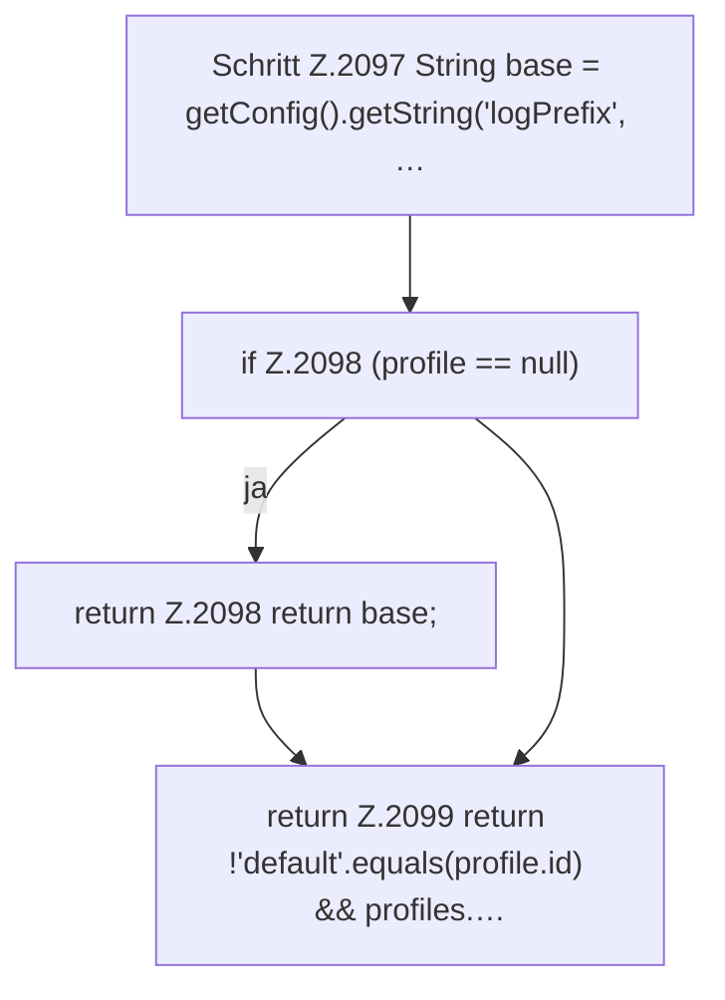

[[00 Start]] › [[Child-Prozess]] › [[Startablauf]] › [[FabricLauncherPlugin.consolePrefix]]

# FabricLauncherPlugin.consolePrefix

`FabricLauncherPlugin.consolePrefix(ServerProfile profile)` [src/main/java/de/aichele/childlauncher/FabricLauncherPlugin.java:2096–2100](https://github.com/Sciddie/minecraft-serverhoster-plugin/blob/95b02b953b0b4c23673e900e021a7c3c844aa37d/src/main/java/de/aichele/childlauncher/FabricLauncherPlugin.java#L2096-L2100)



```knoten
Schritt Z.2097 String base = getConfig().getString('logPrefix', …
  Zeile 2097: liest die Config. `String base = getConfig().getString('logPrefix', …`
if Z.2098 (profile == null)
  Zeile 2098: prüft `(profile == null)`.
return Z.2098 return base;
  Zeile 2098: Rückgabe `return base;`.
return Z.2099 return !'default'.equals(profile.id) && profiles.…
  Zeile 2099: Rückgabe `return !'default'.equals(profile.id) && profiles.…`.
```

- `consolePrefix` in `src/main/java/de/aichele/childlauncher/FabricLauncherPlugin.java`
