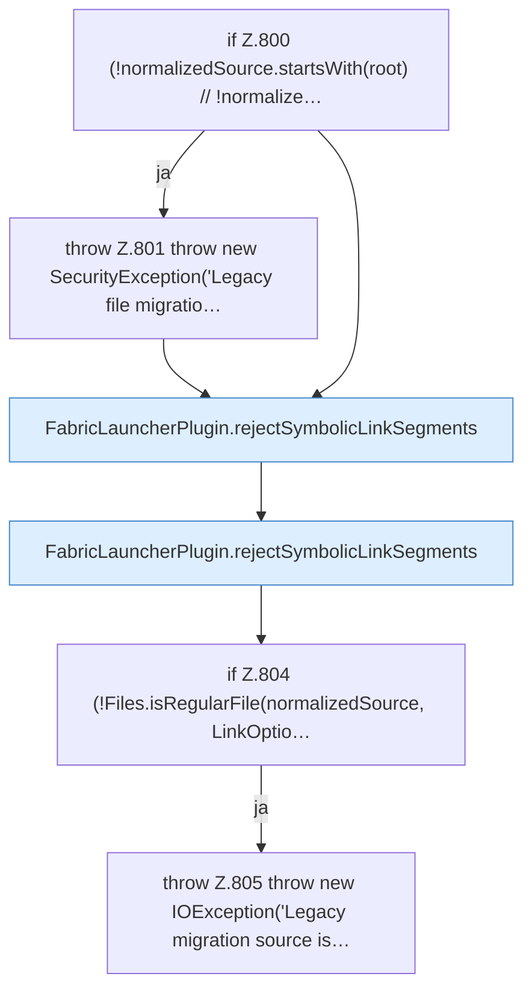

[[00 Start]] › [[Plugin-Kern]] › [[Setup]] › [[Setup-Aufraeumen]] › [[FabricLauncherPlugin.copyLegacyFile]] › [[FabricLauncherPlugin.copyLegacyFile.Teil1]]

# FabricLauncherPlugin.copyLegacyFile.Teil1



```knoten
if Z.800 (!normalizedSource.startsWith(root) // !normalize…
  Zeile 800: prüft `(!normalizedSource.startsWith(root) // !normalize…`.
throw Z.801 throw new SecurityException('Legacy file migratio…
  Zeile 801: Abbruch `throw new SecurityException('Legacy file migratio…`.
FabricLauncherPlugin.rejectSymbolicLinkSegments
  `rejectSymbolicLinkSegments` in `FabricLauncherPlugin.java`.
if Z.804 (!Files.isRegularFile(normalizedSource, LinkOptio…
  Zeile 804: prüft `(!Files.isRegularFile(normalizedSource, LinkOptio…`.
throw Z.805 throw new IOException('Legacy migration source is…
  Zeile 805: Abbruch `throw new IOException('Legacy migration source is…`.
```

- Fortsetzung von `FabricLauncherPlugin.copyLegacyFile`, Quellreihenfolge.
