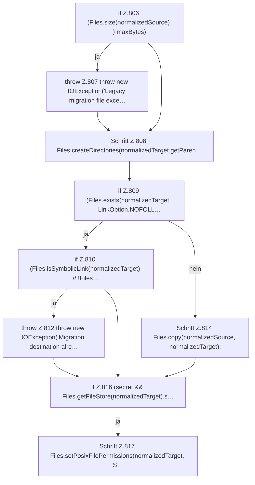

[[00 Start]] › [[Plugin-Kern]] › [[Setup]] › [[Setup-Aufraeumen]] › [[FabricLauncherPlugin.copyLegacyFile]] › [[FabricLauncherPlugin.copyLegacyFile.Teil2]]

# FabricLauncherPlugin.copyLegacyFile.Teil2



```knoten
if Z.806 (Files.size(normalizedSource) ) maxBytes)
  Zeile 806: prüft `(Files.size(normalizedSource) ) maxBytes)`.
throw Z.807 throw new IOException('Legacy migration file exce…
  Zeile 807: Abbruch `throw new IOException('Legacy migration file exce…`.
Schritt Z.808 Files.createDirectories(normalizedTarget.getParen…
  Zeile 808: Dateioperation. `Files.createDirectories(normalizedTarget.getParen…`
if Z.809 (Files.exists(normalizedTarget, LinkOption.NOFOLL…
  Zeile 809: prüft `(Files.exists(normalizedTarget, LinkOption.NOFOLL…`.
if Z.810 (Files.isSymbolicLink(normalizedTarget) // !Files…
  Zeile 810: prüft `(Files.isSymbolicLink(normalizedTarget) // !Files…`.
throw Z.812 throw new IOException('Migration destination alre…
  Zeile 812: Abbruch `throw new IOException('Migration destination alre…`.
Schritt Z.814 Files.copy(normalizedSource, normalizedTarget);
  Zeile 814: Dateioperation. `Files.copy(normalizedSource, normalizedTarget);`
if Z.816 (secret && Files.getFileStore(normalizedTarget).s…
  Zeile 816: prüft `(secret && Files.getFileStore(normalizedTarget).s…`.
Schritt Z.817 Files.setPosixFilePermissions(normalizedTarget, S…
  Zeile 817: setzt POSIX-Dateirechte. `Files.setPosixFilePermissions(normalizedTarget, S…`
```

- Fortsetzung von `FabricLauncherPlugin.copyLegacyFile`, Quellreihenfolge.
