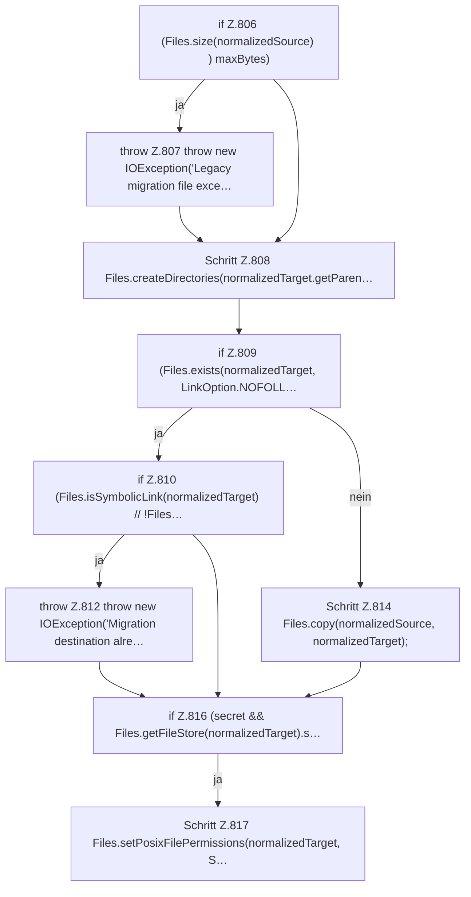

[[00 Start]] › [[Plugin-Kern]] › [[Setup]] › [[Setup-Aufraeumen]] › [[FabricLauncherPlugin.copyLegacyFile]] › [[FabricLauncherPlugin.copyLegacyFile.Teil2]]

# FabricLauncherPlugin.copyLegacyFile.Teil2

- Fortsetzung von `FabricLauncherPlugin.copyLegacyFile`, Quellreihenfolge.
