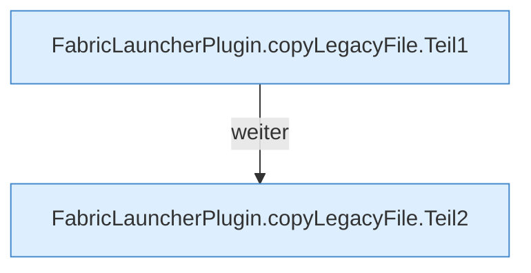

[[00 Start]] › [[Plugin-Kern]] › [[Setup]] › [[Setup-Aufraeumen]] › [[FabricLauncherPlugin.copyLegacyFile]]

# FabricLauncherPlugin.copyLegacyFile

`FabricLauncherPlugin.copyLegacyFile(Path sourceRoot, Path source, Path targetRoot, Path target, long maxBytes, boolean secret)` [src/main/java/de/aichele/childlauncher/FabricLauncherPlugin.java:794–820](https://github.com/Sciddie/minecraft-serverhoster-plugin/blob/95b02b953b0b4c23673e900e021a7c3c844aa37d/src/main/java/de/aichele/childlauncher/FabricLauncherPlugin.java#L794-L820)

- `copyLegacyFile` in `src/main/java/de/aichele/childlauncher/FabricLauncherPlugin.java`
