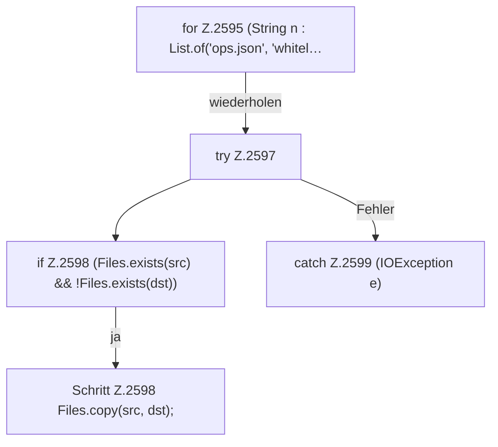

[[00 Start]] › [[Plugin-Kern]] › [[Properties]] › [[FabricLauncherPlugin.copyPlayerFiles]] › [[FabricLauncherPlugin.copyPlayerFiles.Z2595]]

# FabricLauncherPlugin.copyPlayerFiles.Z2595

- Fortsetzung von `FabricLauncherPlugin.copyPlayerFiles`, Quellreihenfolge.
