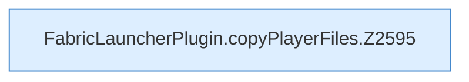

[[00 Start]] › [[Plugin-Kern]] › [[Properties]] › [[FabricLauncherPlugin.copyPlayerFiles]]

# FabricLauncherPlugin.copyPlayerFiles

`FabricLauncherPlugin.copyPlayerFiles(Path wd)` [src/main/java/de/aichele/childlauncher/FabricLauncherPlugin.java:2593–2601](https://github.com/Sciddie/minecraft-serverhoster-plugin/blob/95b02b953b0b4c23673e900e021a7c3c844aa37d/src/main/java/de/aichele/childlauncher/FabricLauncherPlugin.java#L2593-L2601)



```knoten
FabricLauncherPlugin.copyPlayerFiles.Z2595
  Fortsetzung des Ablaufs ab Zeile 2595.
```

- `copyPlayerFiles` in `src/main/java/de/aichele/childlauncher/FabricLauncherPlugin.java`
