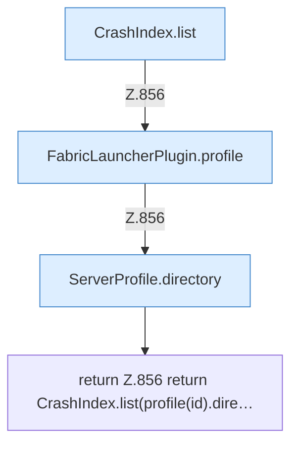

[[00 Start]] › [[Plugin-Kern]] › [[Diagnose]] › [[FabricLauncherPlugin.crashFiles]]

# FabricLauncherPlugin.crashFiles

`FabricLauncherPlugin.crashFiles(String id)` [src/main/java/de/aichele/childlauncher/FabricLauncherPlugin.java:856–856](https://github.com/Sciddie/minecraft-serverhoster-plugin/blob/95b02b953b0b4c23673e900e021a7c3c844aa37d/src/main/java/de/aichele/childlauncher/FabricLauncherPlugin.java#L856-L856)



```knoten
CrashIndex.list
  Dieser Teil zeigt das. Im [[Glossar#Quelltext|Quelltext]] heißt das `list`.
FabricLauncherPlugin.profile
  Das [[Glossar#Plugin|Plugin]] macht hier einen einzelnen Schritt. Eine Ebene tiefer steht er genauer. Im [[Glossar#Quelltext|Quelltext]] heißt das `profile`.
ServerProfile.directory
  Die Serverbeschreibung macht hier einen einzelnen Schritt. Eine Ebene tiefer steht er genauer. Im [[Glossar#Quelltext|Quelltext]] heißt das `directory`.
return Z.856 return CrashIndex.list(profile(id).dire…
  Hier endet die [[Glossar#Funktion|Funktion]] und liefert ein Ergebnis zurück. Das steht in [[Glossar#Zeile|Zeile]] 856.
```

> [!knoten]- Was die Blöcke tun
> - **CrashIndex.list**: Dieser Teil zeigt das. Im [[Glossar#Quelltext|Quelltext]] heißt das `list`.
> - **FabricLauncherPlugin.profile**: Das [[Glossar#Plugin|Plugin]] macht hier einen einzelnen Schritt. Eine Ebene tiefer steht er genauer. Im [[Glossar#Quelltext|Quelltext]] heißt das `profile`.
> - **ServerProfile.directory**: Die Serverbeschreibung macht hier einen einzelnen Schritt. Eine Ebene tiefer steht er genauer. Im [[Glossar#Quelltext|Quelltext]] heißt das `directory`.
> - **return Z.856 return CrashIndex.list(profile(id).dire…**: Hier endet die [[Glossar#Funktion|Funktion]] und liefert ein Ergebnis zurück. Das steht in [[Glossar#Zeile|Zeile]] 856.

- Listet die [[Glossar#Absturzbericht|Absturzberichte]].
