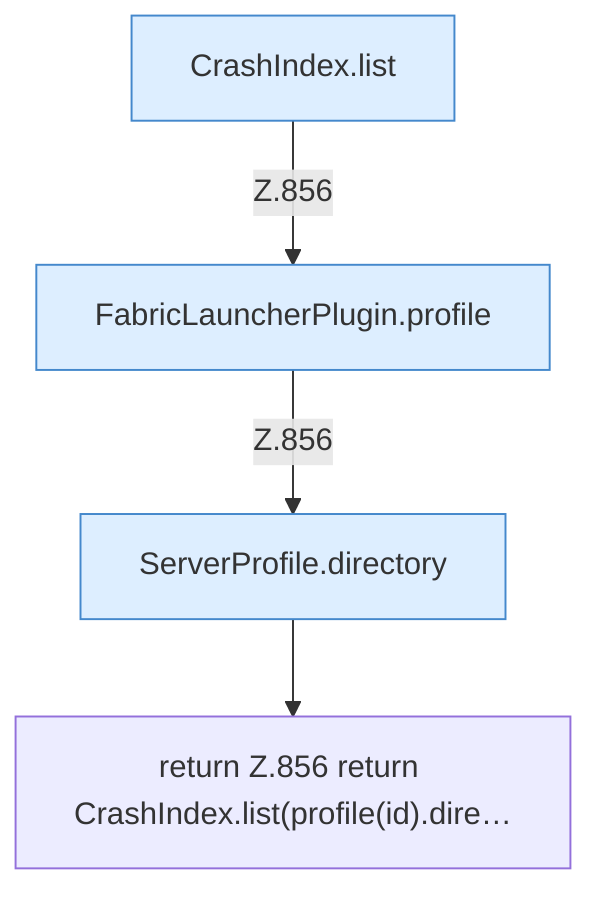

[[00 Start]] › [[Plugin-Kern]] › [[Diagnose]] › [[FabricLauncherPlugin.crashFiles]]

# FabricLauncherPlugin.crashFiles

`FabricLauncherPlugin.crashFiles(String id)` [src/main/java/de/aichele/childlauncher/FabricLauncherPlugin.java:856–856](https://github.com/Sciddie/minecraft-serverhoster-plugin/blob/95b02b953b0b4c23673e900e021a7c3c844aa37d/src/main/java/de/aichele/childlauncher/FabricLauncherPlugin.java#L856-L856)

- `crashFiles` in `src/main/java/de/aichele/childlauncher/FabricLauncherPlugin.java`
