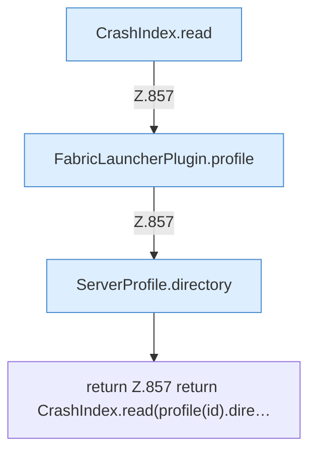

[[00 Start]] › [[Plugin-Kern]] › [[Diagnose]] › [[FabricLauncherPlugin.crashText]]

# FabricLauncherPlugin.crashText

`FabricLauncherPlugin.crashText(String id, String file)` [src/main/java/de/aichele/childlauncher/FabricLauncherPlugin.java:857–857](https://github.com/Sciddie/minecraft-serverhoster-plugin/blob/95b02b953b0b4c23673e900e021a7c3c844aa37d/src/main/java/de/aichele/childlauncher/FabricLauncherPlugin.java#L857-L857)



```knoten
CrashIndex.read
  Liest `read`. Ruft `open`, `resolve`, `query`.
FabricLauncherPlugin.profile
  `profile` in `FabricLauncherPlugin.java`.
ServerProfile.directory
  `directory` in `ServerProfile.java`.
return Z.857 return CrashIndex.read(profile(id).dire…
  Zeile 857: Rückgabe `return CrashIndex.read(profile(id).dire…`.
```

- `crashText` in `src/main/java/de/aichele/childlauncher/FabricLauncherPlugin.java`
