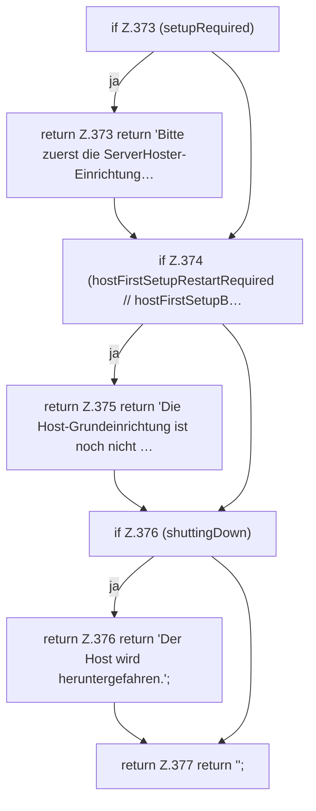

[[00 Start]] › [[Plugin-Kern]] › [[Setup]] › [[Setup-Dialog]] › [[FabricLauncherPlugin.dashboardStartBlockReason]]

# FabricLauncherPlugin.dashboardStartBlockReason

`FabricLauncherPlugin.dashboardStartBlockReason()` [src/main/java/de/aichele/childlauncher/FabricLauncherPlugin.java:372–378](https://github.com/Sciddie/minecraft-serverhoster-plugin/blob/95b02b953b0b4c23673e900e021a7c3c844aa37d/src/main/java/de/aichele/childlauncher/FabricLauncherPlugin.java#L372-L378)

- `dashboardStartBlockReason` in `src/main/java/de/aichele/childlauncher/FabricLauncherPlugin.java`
