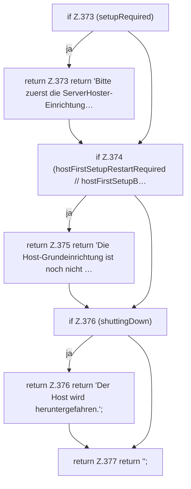

[[00 Start]] › [[Plugin-Kern]] › [[Setup]] › [[Setup-Dialog]] › [[FabricLauncherPlugin.dashboardStartBlockReason]]

# FabricLauncherPlugin.dashboardStartBlockReason

`FabricLauncherPlugin.dashboardStartBlockReason()` [src/main/java/de/aichele/childlauncher/FabricLauncherPlugin.java:372–378](https://github.com/Sciddie/minecraft-serverhoster-plugin/blob/95b02b953b0b4c23673e900e021a7c3c844aa37d/src/main/java/de/aichele/childlauncher/FabricLauncherPlugin.java#L372-L378)



```knoten
if Z.373 (setupRequired)
  Zeile 373: prüft `(setupRequired)`.
return Z.373 return 'Bitte zuerst die ServerHoster-Einrichtung…
  Zeile 373: Rückgabe `return 'Bitte zuerst die ServerHoster-Einrichtung…`.
if Z.374 (hostFirstSetupRestartRequired // hostFirstSetupB…
  Zeile 374: prüft `(hostFirstSetupRestartRequired // hostFirstSetupB…`.
return Z.375 return 'Die Host-Grundeinrichtung ist noch nicht …
  Zeile 375: Rückgabe `return 'Die Host-Grundeinrichtung ist noch nicht …`.
if Z.376 (shuttingDown)
  Zeile 376: prüft `(shuttingDown)`.
return Z.376 return 'Der Host wird heruntergefahren.';
  Zeile 376: Rückgabe `return 'Der Host wird heruntergefahren.';`.
return Z.377 return '';
  Zeile 377: Rückgabe `return '';`.
```

> [!knoten]- Was die Blöcke tun
> - **if Z.373 (setupRequired)**: Zeile 373: prüft `(setupRequired)`.
> - **return Z.373 return 'Bitte zuerst die ServerHoster-Einrichtung…**: Zeile 373: Rückgabe `return 'Bitte zuerst die ServerHoster-Einrichtung…`.
> - **if Z.374 (hostFirstSetupRestartRequired // hostFirstSetupB…**: Zeile 374: prüft `(hostFirstSetupRestartRequired // hostFirstSetupB…`.
> - **return Z.375 return 'Die Host-Grundeinrichtung ist noch nicht …**: Zeile 375: Rückgabe `return 'Die Host-Grundeinrichtung ist noch nicht …`.
> - **if Z.376 (shuttingDown)**: Zeile 376: prüft `(shuttingDown)`.
> - **return Z.376 return 'Der Host wird heruntergefahren.';**: Zeile 376: Rückgabe `return 'Der Host wird heruntergefahren.';`.
> - **return Z.377 return '';**: Zeile 377: Rückgabe `return '';`.

- Das [[Glossar#Plugin|Plugin]] startet hier einen Schritt. Eine Ebene tiefer steht er genauer.
- `dashboardStartBlockReason` in `src/main/java/de/aichele/childlauncher/FabricLauncherPlugin.java`
