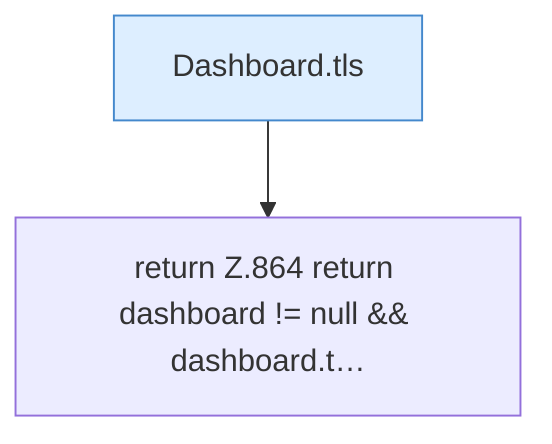

[[00 Start]] › [[Plugin-Kern]] › [[Host-Pfade]] › [[FabricLauncherPlugin.dashboardTls]]

# FabricLauncherPlugin.dashboardTls

`FabricLauncherPlugin.dashboardTls()` [src/main/java/de/aichele/childlauncher/FabricLauncherPlugin.java:864–864](https://github.com/Sciddie/minecraft-serverhoster-plugin/blob/95b02b953b0b4c23673e900e021a7c3c844aa37d/src/main/java/de/aichele/childlauncher/FabricLauncherPlugin.java#L864-L864)



```knoten
Dashboard.tls
  Liest, ob die Verbindung zur [[Glossar#Bedienseite|Bedienseite]] verschlüsselt sein soll. Im [[Glossar#Quelltext|Quelltext]] heißt das `tls`.
return Z.864 return dashboard != null && dashboard.t…
  Hier endet die [[Glossar#Funktion|Funktion]] und liefert ein Ergebnis zurück. Das steht in [[Glossar#Zeile|Zeile]] 864.
```

> [!knoten]- Was die Blöcke tun
> - **Dashboard.tls**: Liest, ob die Verbindung zur [[Glossar#Bedienseite|Bedienseite]] verschlüsselt sein soll. Im [[Glossar#Quelltext|Quelltext]] heißt das `tls`.
> - **return Z.864 return dashboard != null && dashboard.t…**: Hier endet die [[Glossar#Funktion|Funktion]] und liefert ein Ergebnis zurück. Das steht in [[Glossar#Zeile|Zeile]] 864.

- Liest, ob die [[Glossar#Bedienseite|Bedienseite]] verschlüsselt erreichbar sein soll.
