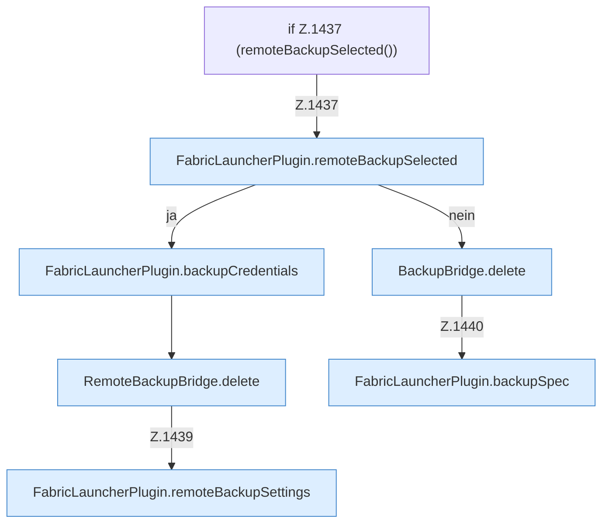

[[00 Start]] › [[Backup]] › [[Backup-Dateien]] › [[FabricLauncherPlugin.deleteBackup]] › [[FabricLauncherPlugin.deleteBackup.Z1437]]

# FabricLauncherPlugin.deleteBackup.Z1437

- Fortsetzung von `FabricLauncherPlugin.deleteBackup`, Quellreihenfolge.
