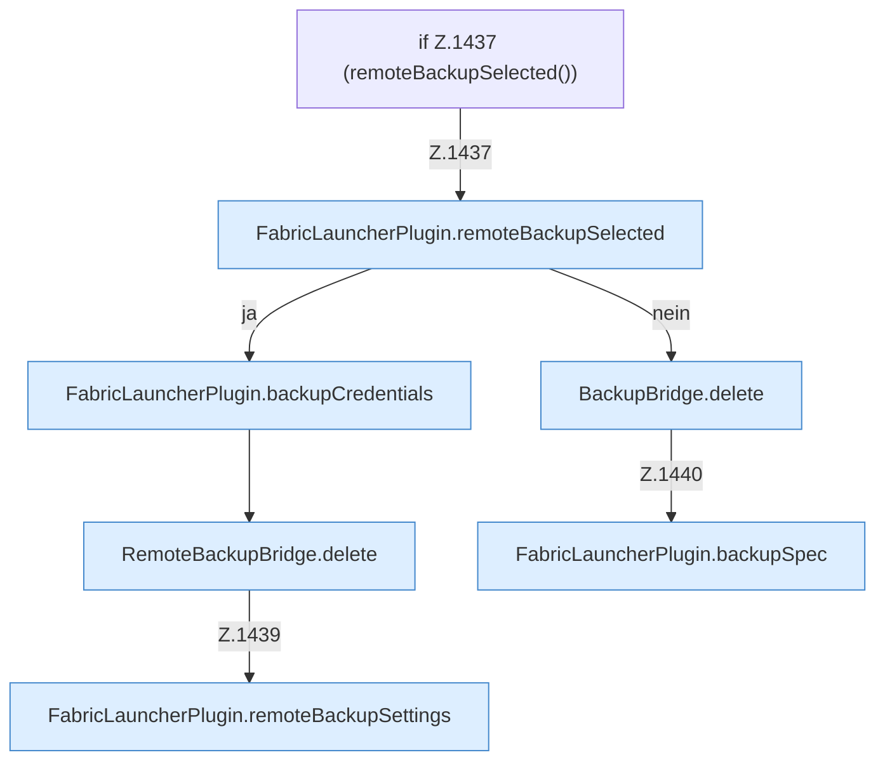

[[00 Start]] › [[Backup]] › [[Backup-Dateien]] › [[FabricLauncherPlugin.deleteBackup]] › [[FabricLauncherPlugin.deleteBackup.Z1437]]

# FabricLauncherPlugin.deleteBackup.Z1437



```knoten
if Z.1437 (remoteBackupSelected())
  Zeile 1437: prüft `(remoteBackupSelected())`.
FabricLauncherPlugin.remoteBackupSelected
  Das [[Glossar#Plugin|Plugin]] sichert die Auswahl. `remoteBackupSelected` in `FabricLauncherPlugin.java`.
FabricLauncherPlugin.backupCredentials
  Das [[Glossar#Plugin|Plugin]] sichert die Zugangsdaten. Sichert `backupCredentials`. Ruft `load`.
RemoteBackupBridge.delete
  Die Sicherung über das Netz löscht das. Löscht `delete`. Ruft `safeId`, `named`, `connect`.
FabricLauncherPlugin.remoteBackupSettings
  Das [[Glossar#Plugin|Plugin]] sichert die [[Glossar#Einstellungen|Einstellungen]]. `remoteBackupSettings` in `FabricLauncherPlugin.java`.
BackupBridge.delete
  Die Sicherung auf diesem Rechner löscht das. Löscht `delete`. Ruft `file`.
FabricLauncherPlugin.backupSpec
  Das [[Glossar#Plugin|Plugin]] sichert die Vorgabe. Sichert `backupSpec`.
```

> [!knoten]- Was die Blöcke tun
> - **if Z.1437 (remoteBackupSelected())**: Zeile 1437: prüft `(remoteBackupSelected())`.
> - **FabricLauncherPlugin.remoteBackupSelected**: Das [[Glossar#Plugin|Plugin]] sichert die Auswahl. `remoteBackupSelected` in `FabricLauncherPlugin.java`.
> - **FabricLauncherPlugin.backupCredentials**: Das [[Glossar#Plugin|Plugin]] sichert die Zugangsdaten. Sichert `backupCredentials`. Ruft `load`.
> - **RemoteBackupBridge.delete**: Die Sicherung über das Netz löscht das. Löscht `delete`. Ruft `safeId`, `named`, `connect`.
> - **FabricLauncherPlugin.remoteBackupSettings**: Das [[Glossar#Plugin|Plugin]] sichert die [[Glossar#Einstellungen|Einstellungen]]. `remoteBackupSettings` in `FabricLauncherPlugin.java`.
> - **BackupBridge.delete**: Die Sicherung auf diesem Rechner löscht das. Löscht `delete`. Ruft `file`.
> - **FabricLauncherPlugin.backupSpec**: Das [[Glossar#Plugin|Plugin]] sichert die Vorgabe. Sichert `backupSpec`.

- Der Ablauf geht in [[Glossar#Zeile|Zeile]] 1437 weiter. Eine Ebene tiefer steht er genauer.
- Fortsetzung von `FabricLauncherPlugin.deleteBackup`.
