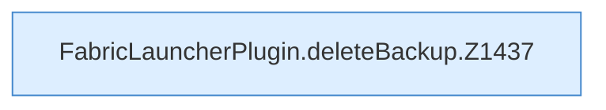

[[00 Start]] › [[Backup]] › [[Backup-Dateien]] › [[FabricLauncherPlugin.deleteBackup]]

# FabricLauncherPlugin.deleteBackup

`FabricLauncherPlugin.deleteBackup(String id, String name)` [src/main/java/de/aichele/childlauncher/FabricLauncherPlugin.java:1436–1441](https://github.com/Sciddie/minecraft-serverhoster-plugin/blob/95b02b953b0b4c23673e900e021a7c3c844aa37d/src/main/java/de/aichele/childlauncher/FabricLauncherPlugin.java#L1436-L1441)



```knoten
FabricLauncherPlugin.deleteBackup.Z1437
  Der Ablauf geht in [[Glossar#Zeile|Zeile]] 1437 weiter. Eine Ebene tiefer steht er genauer. Im [[Glossar#Quelltext|Quelltext]] heißt das `Z1437`.
```

> [!knoten]- Was die Blöcke tun
> - **FabricLauncherPlugin.deleteBackup.Z1437**: Der Ablauf geht in [[Glossar#Zeile|Zeile]] 1437 weiter. Eine Ebene tiefer steht er genauer. Im [[Glossar#Quelltext|Quelltext]] heißt das `Z1437`.

- Das [[Glossar#Plugin|Plugin]] löscht die [[Glossar#Sicherungskopie|Sicherungskopie]].
