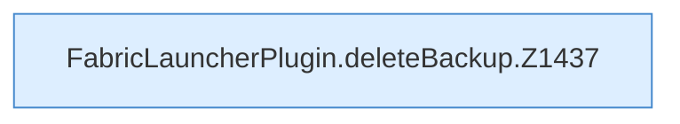

[[00 Start]] › [[Backup]] › [[Backup-Dateien]] › [[FabricLauncherPlugin.deleteBackup]]

# FabricLauncherPlugin.deleteBackup

`FabricLauncherPlugin.deleteBackup(String id, String name)` [src/main/java/de/aichele/childlauncher/FabricLauncherPlugin.java:1436–1441](https://github.com/Sciddie/minecraft-serverhoster-plugin/blob/95b02b953b0b4c23673e900e021a7c3c844aa37d/src/main/java/de/aichele/childlauncher/FabricLauncherPlugin.java#L1436-L1441)

- `deleteBackup` in `src/main/java/de/aichele/childlauncher/FabricLauncherPlugin.java`
