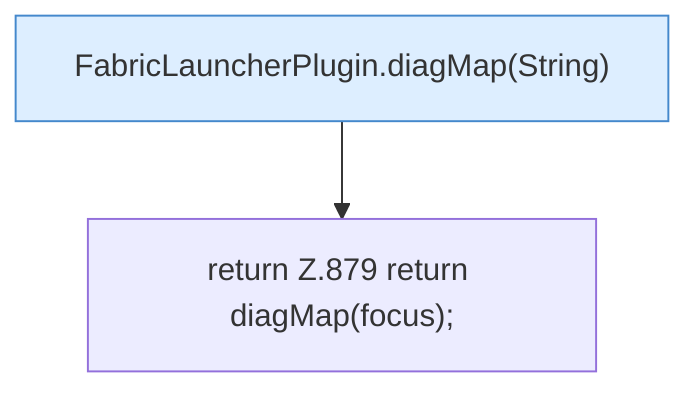

[[00 Start]] › [[Plugin-Kern]] › [[Diagnose]] › [[FabricLauncherPlugin.diagMap()]]

# FabricLauncherPlugin.diagMap()

`FabricLauncherPlugin.diagMap()` [src/main/java/de/aichele/childlauncher/FabricLauncherPlugin.java:879–879](https://github.com/Sciddie/minecraft-serverhoster-plugin/blob/95b02b953b0b4c23673e900e021a7c3c844aa37d/src/main/java/de/aichele/childlauncher/FabricLauncherPlugin.java#L879-L879)



```knoten
FabricLauncherPlugin.diagMap(String)
  Sammelt die [[Glossar#Diagnose|Diagnose]] in einer Übersicht. Im [[Glossar#Quelltext|Quelltext]] heißt das `diagMap(String)`.
return Z.879 return diagMap(focus);
  Hier endet die [[Glossar#Funktion|Funktion]] und liefert ein Ergebnis zurück. Das steht in [[Glossar#Zeile|Zeile]] 879.
```

> [!knoten]- Was die Blöcke tun
> - **FabricLauncherPlugin.diagMap(String)**: Sammelt die [[Glossar#Diagnose|Diagnose]] in einer Übersicht. Im [[Glossar#Quelltext|Quelltext]] heißt das `diagMap(String)`.
> - **return Z.879 return diagMap(focus);**: Hier endet die [[Glossar#Funktion|Funktion]] und liefert ein Ergebnis zurück. Das steht in [[Glossar#Zeile|Zeile]] 879.

- Sammelt die [[Glossar#Diagnose|Diagnose]] in einer Übersicht.
