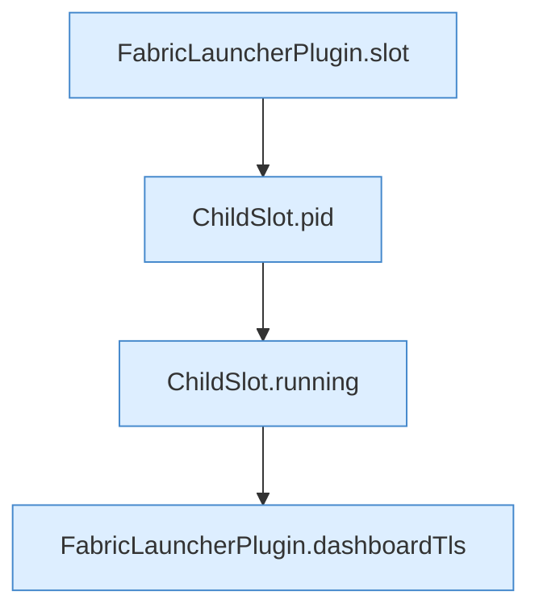

[[00 Start]] › [[Plugin-Kern]] › [[Diagnose]] › [[FabricLauncherPlugin.diagMap(String)]] › [[FabricLauncherPlugin.diagMap(String).Teil1]]

# FabricLauncherPlugin.diagMap(String).Teil1



```knoten
FabricLauncherPlugin.slot
  Das [[Glossar#Plugin|Plugin]] macht hier einen einzelnen Schritt. Eine Ebene tiefer steht er genauer. `slot` in `FabricLauncherPlugin.java`. Ruft `profile`, `ChildSlot`.
ChildSlot.pid
  Dieser Teil macht hier einen einzelnen Schritt. Eine Ebene tiefer steht er genauer. Liefert die Prozessnummer `pid`.
ChildSlot.running
  Dieser Teil prüft, ob läuft, das. Sagt, ob der [[Glossar#Prozess|Prozess]] läuft `running`.
FabricLauncherPlugin.dashboardTls
  Liest, ob die [[Glossar#Bedienseite|Bedienseite]] verschlüsselt erreichbar sein soll. `dashboardTls` in `FabricLauncherPlugin.java`. Ruft `tls`.
```

> [!knoten]- Was die Blöcke tun
> - **FabricLauncherPlugin.slot**: Das [[Glossar#Plugin|Plugin]] macht hier einen einzelnen Schritt. Eine Ebene tiefer steht er genauer. `slot` in `FabricLauncherPlugin.java`. Ruft `profile`, `ChildSlot`.
> - **ChildSlot.pid**: Dieser Teil macht hier einen einzelnen Schritt. Eine Ebene tiefer steht er genauer. Liefert die Prozessnummer `pid`.
> - **ChildSlot.running**: Dieser Teil prüft, ob läuft, das. Sagt, ob der [[Glossar#Prozess|Prozess]] läuft `running`.
> - **FabricLauncherPlugin.dashboardTls**: Liest, ob die [[Glossar#Bedienseite|Bedienseite]] verschlüsselt erreichbar sein soll. `dashboardTls` in `FabricLauncherPlugin.java`. Ruft `tls`.

- Ein weiterer Abschnitt derselben Übersicht.
- Fortsetzung von `FabricLauncherPlugin.diagMap(String)`.
