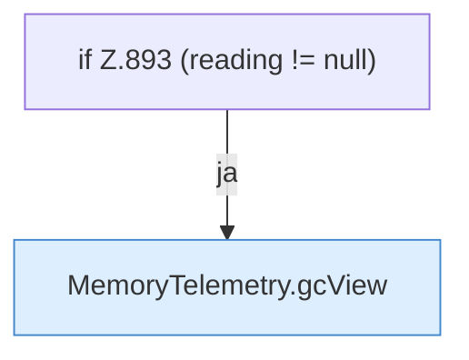

[[00 Start]] › [[Plugin-Kern]] › [[Diagnose]] › [[FabricLauncherPlugin.diagMap(String)]] › [[FabricLauncherPlugin.diagMap(String).Teil2.Z893]]

# FabricLauncherPlugin.diagMap(String).Teil2.Z893

- Fortsetzung von `FabricLauncherPlugin.diagMap(String).Teil2`, Quellreihenfolge.
