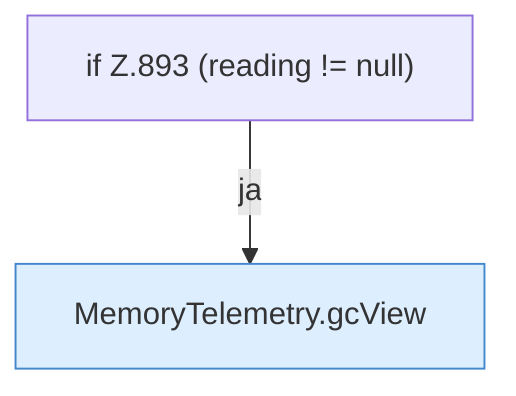

[[00 Start]] › [[Plugin-Kern]] › [[Diagnose]] › [[FabricLauncherPlugin.diagMap(String)]] › [[FabricLauncherPlugin.diagMap(String).Teil2.Z893]]

# FabricLauncherPlugin.diagMap(String).Teil2.Z893



```knoten
if Z.893 (reading != null)
  Zeile 893: prüft `(reading != null)`.
MemoryTelemetry.gcView
  Die Messung kümmert sich um die Ansicht. `gcView` in `MemoryTelemetry.java`.
```

> [!knoten]- Was die Blöcke tun
> - **if Z.893 (reading != null)**: Zeile 893: prüft `(reading != null)`.
> - **MemoryTelemetry.gcView**: Die Messung kümmert sich um die Ansicht. `gcView` in `MemoryTelemetry.java`.

- Der Ablauf geht in [[Glossar#Zeile|Zeile]] 893 weiter. Eine Ebene tiefer steht er genauer.
- Fortsetzung von `FabricLauncherPlugin.diagMap(String).Teil2`.
