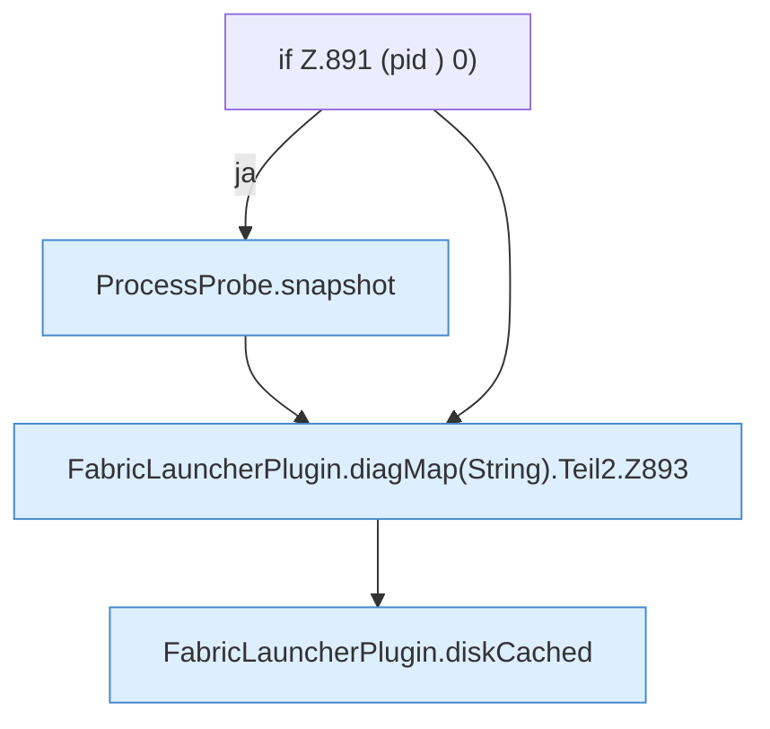

[[00 Start]] › [[Plugin-Kern]] › [[Diagnose]] › [[FabricLauncherPlugin.diagMap(String)]] › [[FabricLauncherPlugin.diagMap(String).Teil2]]

# FabricLauncherPlugin.diagMap(String).Teil2



```knoten
if Z.891 (pid ) 0)
  Zeile 891: prüft `(pid ) 0)`.
ProcessProbe.snapshot
  `snapshot` in `ProcessProbe.java`. Ruft `kb`.
FabricLauncherPlugin.diagMap(String).Teil2.Z893
  Fortsetzung des Ablaufs ab Zeile 893.
FabricLauncherPlugin.diskCached
  Liest die Platte `diskCached`. Ruft `disk`, `workDir`.
```

- Fortsetzung von `FabricLauncherPlugin.diagMap(String)`, Quellreihenfolge.
