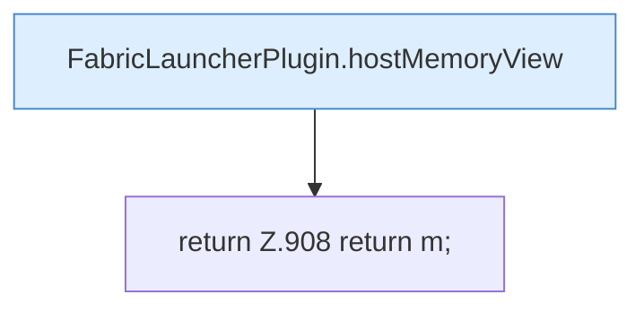

[[00 Start]] › [[Plugin-Kern]] › [[Diagnose]] › [[FabricLauncherPlugin.diagMap(String)]] › [[FabricLauncherPlugin.diagMap(String).Teil3]]

# FabricLauncherPlugin.diagMap(String).Teil3

- Fortsetzung von `FabricLauncherPlugin.diagMap(String)`, Quellreihenfolge.
